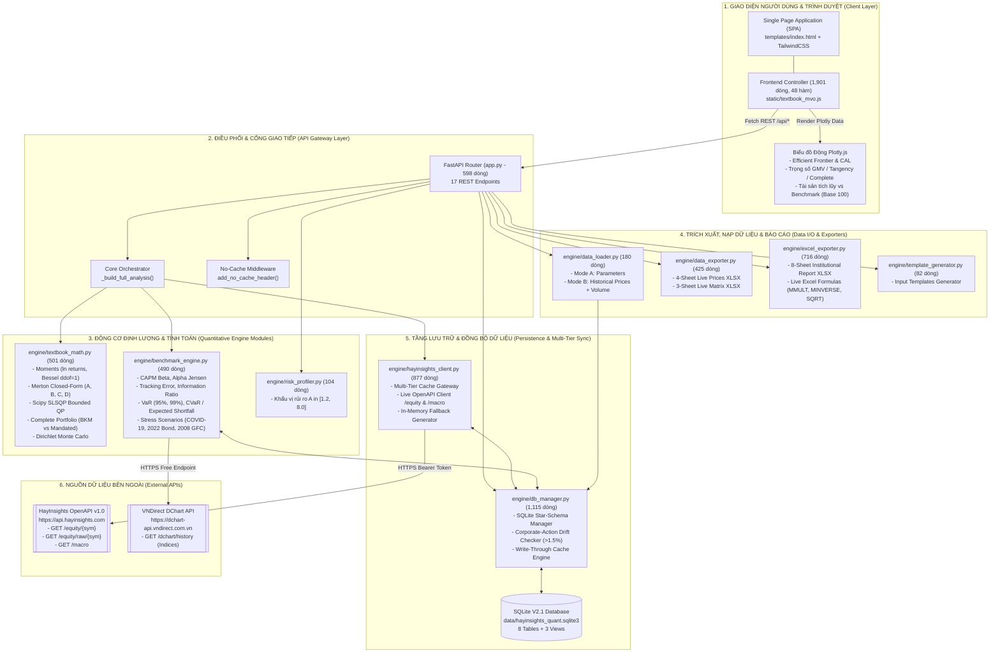
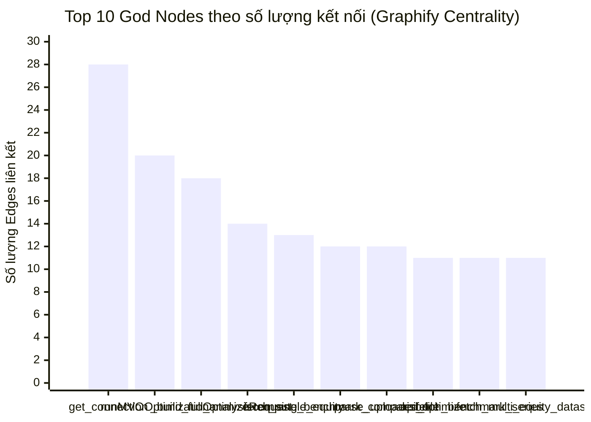

# 00. Master Architecture & Graphify Knowledge Graph Map

> [!IMPORTANT]
> **Phiên bản Hệ thống**: Portfolio Optimization by Khim — v2.4 Institutional Edition
> **Phương pháp tài liệu**: Kết hợp **Graphify Knowledge Graph (AST Tree-sitter)** và **Đặc tả Định lượng Chuyên sâu (Quantitative Specification)**.
> **Các tài nguyên trực quan đi kèm**:
> - [Graphify Interactive 3D/2D Graph Viewer](file:///d:/Project%20Khim/portfolio-optimization-by-Khim-main/graphify-out/graph.html) (`graphify-out/graph.html`)
> - [Graphify Multi-Section Call-Flow Architecture](file:///d:/Project%20Khim/portfolio-optimization-by-Khim-main/graphify-out/portfolio-optimization-by-Khim-main-callflow.html) (`graphify-out/portfolio-optimization-by-Khim-main-callflow.html`)
> - [Graphify Knowledge Report](file:///d:/Project%20Khim/portfolio-optimization-by-Khim-main/graphify-out/GRAPH_REPORT.md) (`graphify-out/GRAPH_REPORT.md`)

---

## 1. Tổng Quan Kiến Trúc Hệ Thống (Master System Architecture)

Hệ thống **Portfolio Optimization by Khim** là một nền tảng định lượng toàn diện (Full-Stack Quantitative Platform) kết hợp giữa mô hình phân bổ tài sản kinh điển Markowitz (1952) / Merton (1972) và dữ liệu thị trường tài chính Việt Nam (HOSE, HNX, UPCOM) thời gian thực.

Kiến trúc phân tầng được thiết kế theo nguyên lý **Phân tách Trách nhiệm (Separation of Concerns)** và **Độc lập Suy diễn (Deterministic Engine)**:



---

## 2. Số Liệu Đồ Thị Tri Thức Graphify (Graphify Knowledge Graph Metrics)

Dựa trên kết quả phân tích AST tự động từ công cụ **Graphify-Labs/graphify v0.9.105** cho dự án:

| Chỉ số Đồ thị (Graph Metric) | Giá trị Thực tế | Ý nghĩa Kiến trúc |
| :--- | :--- | :--- |
| **Tổng số Nodes (AST Entities)** | **333 nodes** | Bao gồm toàn bộ file, class, function, variable, endpoint và DOM components. |
| **Tổng số Edges (Call/Import Links)** | **746 edges** | 99% liên kết được trích xuất chính xác tuyệt đối từ mã nguồn (`EXTRACTED`), 1% suy diễn ngữ cảnh (`INFERRED`). |
| **Số lượng Phân cụm (Communities)** | **9 communities** | Hệ thống tự động phân rã thành 9 module nghiệp vụ tự nhiên không bị chồng chéo. |
| **Import Cycles (Vòng lặp phụ thuộc)** | **0 (None detected)** | Kiến trúc đạt độ tinh khiết cao, hoàn toàn không có vòng lặp phụ thuộc giữa các module Python. |

### Top 10 "God Nodes" (Các Nút Trung Tâm Có Độ Kết Nối Cao Nhất)

Các hàm và thực thể dưới đây đóng vai trò huyết mạch của toàn bộ hệ thống; bất kỳ sự thay đổi logic nào tại các nút này đều ảnh hưởng trực tiếp đến toàn bộ các phân hệ còn lại:



1. [`get_connection()`](file:///d:/Project%20Khim/portfolio-optimization-by-Khim-main/engine/db_manager.py#L251-L263) (**28 edges**): Nút xương sống của tầng lưu trữ SQLite WAL mode.
2. [`runMVOOptimization()`](file:///d:/Project%20Khim/portfolio-optimization-by-Khim-main/static/textbook_mvo.js#L880-L953) (**20 edges**): Hàm điều phối chính của giao diện Frontend, thu thập tham số và kích hoạt các bộ render UI.
3. [`_build_full_analysis()`](file:///d:/Project%20Khim/portfolio-optimization-by-Khim-main/app.py#L287-L443) (**18 edges**): Nhạc trưởng tối cao tại Backend kết nối toán học Markowitz, Benchmark Attribution và VaR Tail-risk.
4. [`OptimizeRequest`](file:///d:/Project%20Khim/portfolio-optimization-by-Khim-main/app.py#L104-L133) (**14 edges**): Data schema chứa toàn bộ tham số đầu vào.
5. [`fetch_single_equity()`](file:///d:/Project%20Khim/portfolio-optimization-by-Khim-main/engine/hayinsights_client.py#L346-L441) (**13 edges**): Trạm trung chuyển dữ liệu đơn mã cổ phiếu kết hợp bộ đệm 3 tầng.
6. [`compute_benchmark_comparison()`](file:///d:/Project%20Khim/portfolio-optimization-by-Khim-main/engine/benchmark_engine.py#L279-L366) (**12 edges**): Động cơ tính CAPM Beta, Jensen's Alpha và Tracking Error.
7. [`parse_uploaded_file()`](file:///d:/Project%20Khim/portfolio-optimization-by-Khim-main/engine/data_loader.py#L27-L180) (**12 edges**): Bộ bóc tách thông minh 2 chế độ file Excel.
8. [`api_optimize()`](file:///d:/Project%20Khim/portfolio-optimization-by-Khim-main/app.py#L446-L454) (**11 edges**): REST endpoint công khai thực thi tính toán.
9. [`fetch_benchmark_series()`](file:///d:/Project%20Khim/portfolio-optimization-by-Khim-main/engine/benchmark_engine.py#L97-L194) (**11 edges**): Bộ nạp chuỗi chỉ số thị trường từ DB/VNDirect API.
10. [`fetch_multi_equity_dataset()`](file:///d:/Project%20Khim/portfolio-optimization-by-Khim-main/engine/hayinsights_client.py#L469-L547) (**11 edges**): Bộ tổng hợp và căn chỉnh ma trận giá đồng bộ cho $N$ tài sản.

---

## 3. Ma Trận Phụ Thuộc Giữa Các File Backend (Inter-Module Dependency Matrix)

Bảng dưới đây thể hiện chính xác mối quan hệ trực tiếp (Ai gọi Ai) giữa **10 file mã nguồn Python**:

| File Gọi (Caller) | `app.py` | `db_manager.py` | `hayinsights_client.py` | `textbook_math.py` | `benchmark_engine.py` | `data_loader.py` | `data_exporter.py` | `excel_exporter.py` | `risk_profiler.py` | `template_generator.py` |
| :--- | :---: | :---: | :---: | :---: | :---: | :---: | :---: | :---: | :---: | :---: |
| **`app.py`** | — | **CALLS** | **CALLS** | **CALLS** | **CALLS** | **CALLS** | **CALLS** | **CALLS** | **CALLS** | **CALLS** |
| **`engine/db_manager.py`** | — | — | — | — | — | — | — | — | — | — |
| **`engine/hayinsights_client.py`** | — | **CALLS** | — | — | — | — | — | — | — | — |
| **`engine/textbook_math.py`** | — | — | — | — | — | — | — | — | — | — |
| **`engine/benchmark_engine.py`** | — | **CALLS** | **CALLS** | — | — | — | — | — | — | — |
| **`engine/data_loader.py`** | — | **CALLS** | — | **CALLS** | — | — | — | — | — | — |
| **`engine/data_exporter.py`** | — | — | — | — | — | **CALLS** | — | — | — | — |
| **`engine/excel_exporter.py`** | — | — | — | — | — | — | — | — | — | — |
| **`engine/risk_profiler.py`** | — | — | — | — | — | — | — | — | — | — |
| **`engine/template_generator.py`** | — | — | — | — | — | — | — | — | — | — |

> [!NOTE]
> Nhận xét kiến trúc:
> - `engine/textbook_math.py`, `engine/risk_profiler.py`, `engine/template_generator.py`, và `engine/excel_exporter.py` là các **Pure Leaf Modules** (không phụ thuộc ngược lại bất kỳ module nghiệp vụ nào trong dự án), giúp việc kiểm thử độc lập (unit testing) đạt độ tin cậy tuyệt đối.
> - `engine/db_manager.py` là **Data Foundation Module** chỉ tương tác với thư viện chuẩn `sqlite3`, `pandas` và `numpy`.

---

## 4. Sơ Đồ Thực Thể Liên Kết Cơ Sở Dữ Liệu SQLite V2.1 (Star-Schema ERD)

Cơ sở dữ liệu lưu trữ tại `data/hayinsights_quant.sqlite3` được tổ chức theo chuẩn **Kimball Star-Schema** gồm 3 bảng Chiều (Dimension), 4 bảng Sự kiện (Fact) và 1 bảng Nhật ký Hệ thống (Audit Log):

```mermaid
erDiagram
    dim_equities ||--o{ fact_equity_daily_prices : "has daily prices"
    dim_equities ||--o{ fact_equity_financial_ratios : "has periodic ratios"
    dim_market_indices ||--o{ fact_market_indices_daily : "has daily index points"
    dim_macro_indicators ||--o{ fact_macro_time_series : "has observation values"

    dim_equities {
        TEXT symbol PK "Mã CP (e.g. FPT, VCB)"
        TEXT company_name "Tên đầy đủ công ty"
        TEXT exchange "HOSE / HNX / UPCOM"
        TEXT industry_lv1 "Ngành cấp 1"
        TEXT industry_lv2 "Ngành cấp 2"
        INTEGER listed_shares "Số lượng CP niêm yết"
        REAL free_float_ratio "Tỷ lệ CP tự do chuyển nhượng"
        TEXT first_trading_date "Ngày chào sàn"
        TEXT updated_at "Thời điểm cập nhật"
    }

    dim_market_indices {
        TEXT index_code PK "VNINDEX / VN30 / HNX / UPCOM"
        TEXT index_name "Tên chỉ số"
        TEXT exchange "Sàn quản lý"
        TEXT base_date "Ngày gốc"
        REAL base_value "Điểm gốc"
        TEXT updated_at "Thời điểm cập nhật"
    }

    dim_macro_indicators {
        TEXT indicator_code PK "Mã chỉ báo (e.g. CPI_YOY, SBV_REFI_RATE)"
        TEXT indicator_name "Tên chỉ báo"
        TEXT unit "% / Tỷ VND / Điểm"
        TEXT frequency "D / M / Q / Y"
        TEXT source "TCTK / NHNN / HayInsights"
        TEXT description "Mô tả ý nghĩa kinh tế"
    }

    fact_equity_daily_prices {
        TEXT symbol PK,FK "Mã CP -> dim_equities"
        TEXT trading_date PK "Ngày giao dịch (YYYY-MM-DD)"
        REAL close_price "Giá đóng cửa thô (VND)"
        REAL adj_close "Giá đóng cửa điều chỉnh"
        REAL open_price "Giá mở cửa"
        REAL high_price "Giá cao nhất"
        REAL low_price "Giá thấp nhất"
        INTEGER volume "Khối lượng khớp lệnh"
        REAL value_vnd "Giá trị giao dịch"
        REAL simple_return_adj "Lợi suất đơn (P_t / P_{t-1} - 1)"
        REAL log_return_adj "Lợi suất log (ln(P_t / P_{t-1}))"
    }

    fact_market_indices_daily {
        TEXT index_code PK,FK "Mã chỉ số -> dim_market_indices"
        TEXT trading_date PK "Ngày giao dịch (YYYY-MM-DD)"
        REAL close_value "Điểm đóng cửa"
        REAL open_value "Điểm mở cửa"
        REAL high_value "Điểm cao nhất"
        REAL low_value "Điểm thấp nhất"
        INTEGER total_volume "Tổng khối lượng"
        REAL total_value_vnd "Tổng giá trị giao dịch"
        REAL return_pct "Lợi suất đơn"
        REAL log_return "Lợi suất log"
    }

    fact_macro_time_series {
        TEXT indicator_code PK,FK "Mã chỉ báo -> dim_macro_indicators"
        TEXT observation_date PK "Ngày quan sát chuẩn hóa (YYYY-MM-DD)"
        REAL indicator_value "Giá trị chỉ báo"
        TEXT period_type "M / Q / Y"
        TEXT period_label "Nhãn chu kỳ (e.g. Q3/2024)"
    }

    fact_equity_financial_ratios {
        TEXT symbol PK,FK "Mã CP -> dim_equities"
        TEXT report_period PK "Kỳ báo cáo (e.g. 2024Q3)"
        TEXT period_type "Q (Quý) / Y (Năm)"
        REAL pe_ratio "Hệ số P/E"
        REAL pb_ratio "Hệ số P/B"
        REAL roe "Tỷ suất sinh lời trên vốn CSH"
        REAL roa "Tỷ suất sinh lời trên tổng tài sản"
        REAL eps_vnd "Lợi nhuận trên mỗi cổ phiếu"
        REAL bvps_vnd "Giá trị sổ sách mỗi cổ phiếu"
        REAL net_profit_margin "Biên lợi nhuận ròng"
        REAL debt_to_equity "Tỷ lệ Nợ / Vốn CSH"
        REAL market_cap_billion "Vốn hóa thị trường (Tỷ VND)"
        REAL ev_ebitda "Hệ số EV/EBITDA"
    }

    sys_sync_logs {
        INTEGER log_id PK "Tự tăng (Autoincrement)"
        TEXT sync_timestamp "Thời điểm đồng bộ"
        TEXT sync_domain "EQUITY_PRICES / MARKET_INDEX / MACRO / FINANCIAL_RATIOS"
        TEXT target_symbol "Mã đối tượng đồng bộ"
        TEXT endpoint_uri "URI API đã gọi"
        INTEGER records_upserted "Số bản ghi ghi nhận"
        INTEGER drift_detected "Cờ phát hiện lệch giá (0/1)"
        TEXT status "SUCCESS / ERROR / FALLBACK"
        TEXT error_message "Thông điệp lỗi nếu có"
        INTEGER duration_ms "Thời gian thực thi (ms)"
    }
```



---

## 5. Đồ Thị Luồng Gọi Hàm Master (Master Call Graph)

Sơ đồ dưới đây thể hiện chi tiết luồng gọi hàm từ lúc người dùng thao tác trên giao diện trình duyệt đến khi các phép toán ma trận hoàn tất và ghi nhận vào cơ sở dữ liệu:

```mermaid
flowchart TD
    %% Khởi tạo
    START([Người dùng mở ứng dụng]) --> JS_LOAD[DOMContentLoaded in textbook_mvo.js]
    JS_LOAD --> JS_INIT_THEME[initTheme]
    JS_LOAD --> JS_BIND_EVENTS[bindUIEvents]
    JS_LOAD --> JS_PRESETS[loadPresets]
    JS_PRESETS -->|GET /api/presets| API_PRESETS[api_get_presets in app.py]
    API_PRESETS --> HAY_KEY[load_api_key]
    API_PRESETS --> RISK_QUIZ[QUIZ_QUESTIONS]
    API_PRESETS --> HAY_DIR[VN_EQUITY_DIRECTORY]
    API_PRESETS -- Trả về 159 mã + Quiz --> JS_PRESETS
    JS_PRESETS --> JS_BASKET[syncBasketUI: Default FPT, MWG, VCB, HPG, VNM]
    JS_PRESETS --> JS_OPT_TRIGGER[runMVOOptimization]

    %% Luồng Run MVO Optimization
    JS_OPT_TRIGGER --> JS_BUILD_PAYLOAD[buildRequestPayload]
    JS_BUILD_PAYLOAD -->|POST /api/optimize| API_OPT[api_optimize in app.py]
    API_OPT --> ORCH[_build_full_analysis]

    %% Phân nhánh dữ liệu
    ORCH -->|input_mode == 'hayinsights'| HAY_DATASET[fetch_multi_equity_dataset]
    HAY_DATASET --> DB_CACHE_MULTI[get_cached_multi_equity_dataset]
    DB_CACHE_MULTI -->|Cache hit đủ phiên| ORCH_MOMENTS[compute_moments_from_prices]
    DB_CACHE_MULTI -->|Cache miss / thiếu phiên| HAY_SINGLE[fetch_single_equity từng mã]
    HAY_SINGLE -->|GET /equity/{symbol}| API_HAY_REMOTE[[HayInsights REST API]]
    API_HAY_REMOTE --> DB_UPSERT_DRIFT[upsert_equity_prices_with_drift_check]
    DB_UPSERT_DRIFT -->|Kiểm tra lệch >1.5%| DB_UPSERT_DRIFT
    DB_UPSERT_DRIFT --> DB_LOG[record_sync_log]
    HAY_SINGLE --> ORCH_MOMENTS

    ORCH -->|input_mode == 'manual'| MANUAL_MOMENTS[build_moments_from_manual]
    MANUAL_MOMENTS --> ORCH_SOLVE

    ORCH_MOMENTS --> ORCH_SOLVE{Giải bài toán MVO}

    %% Giải toán
    ORCH_SOLVE --> MERTON[solve_merton_closed_form]
    MERTON -->|Tính inv_cov & Vô hướng A, B, C, D| MERTON
    ORCH_SOLVE -->|Nếu Long-Only| SLSQP[solve_long_only_qp]
    SLSQP -->|Scipy minimize SLSQP| SLSQP
    ORCH_SOLVE --> COMP[compute_complete_portfolio]
    COMP -->|Chế độ BKM hoặc Mandated Cash| COMP
    ORCH_SOLVE --> MC[simulate_monte_carlo]
    MC -->|Dirichlet 2,500 danh mục| MC

    %% So sánh Benchmark & VaR
    ORCH --> BM_SERIES[fetch_benchmark_series]
    BM_SERIES --> DB_BM[get_benchmark_series_from_db]
    DB_BM -->|Cache miss| VND_API[[VNDirect DChart API]]
    VND_API --> DB_UPSERT_BM[upsert_market_index_daily]
    BM_SERIES --> BM_ATTR[compute_benchmark_comparison]
    ORCH --> BM_VAR[compute_stress_testing_and_var]

    %% Trả về & Render UI
    ORCH --> API_OPT
    API_OPT -- Trả về 24 trường JSON --> JS_OPT_TRIGGER
    JS_OPT_TRIGGER --> JS_R_KPI[renderKPISummary]
    JS_OPT_TRIGGER --> JS_R_FRONTIER[renderPlotlyFrontier]
    JS_OPT_TRIGGER --> JS_R_WEIGHTS[renderPlotlyWeights]
    JS_OPT_TRIGGER --> JS_R_LOT100[renderWeightsAndLot100Table]
    JS_OPT_TRIGGER --> JS_R_BM[renderBenchmarkTab]
    JS_OPT_TRIGGER --> JS_R_STRESS[renderStressTestingTab]
    JS_OPT_TRIGGER --> JS_R_MAT[renderMatricesTables]
    JS_OPT_TRIGGER --> JS_R_ALG[renderAlgebraStepByStep]
```

---

> [!TIP]
> Tiếp theo, hãy tra cứu chi tiết giải thuật từng hàm trong [01. Backend Python Functions Reference](file:///d:/Project%20Khim/portfolio-optimization-by-Khim-main/docs/01_BACKEND_PYTHON_FUNCTIONS_REFERENCE.md).

