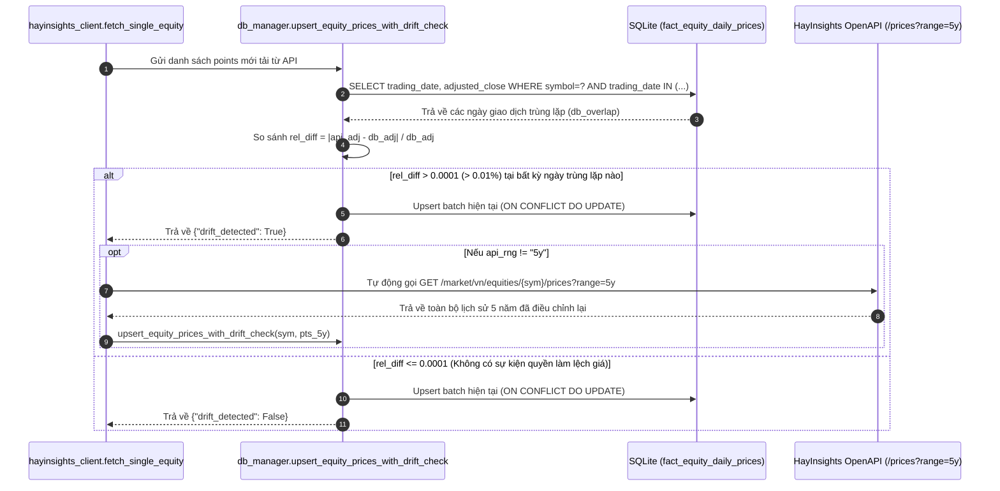

# 02. Database & External API Flows (Audited & Verified v2.4)

> [!IMPORTANT]
> **Phiên bản Cơ sở Dữ liệu**: SQLite Quant Star-Schema V2.1
> **Đường dẫn tệp**: [`data/hayinsights_quant.sqlite3`](file:///d:/Project%20Khim/portfolio-optimization-by-Khim-main/data/hayinsights_quant.sqlite3)
> **Mã nguồn quản trị**: [`engine/db_manager.py`](file:///d:/Project%20Khim/portfolio-optimization-by-Khim-main/engine/db_manager.py) & [`engine/hayinsights_client.py`](file:///d:/Project%20Khim/portfolio-optimization-by-Khim-main/engine/hayinsights_client.py)
> **Trạng thái lưu trữ**: **Pure Dynamic State (0 fact rows ban đầu)**. Dữ liệu chỉ được nạp vào 4 bảng Fact khi thực hiện đồng bộ từ API thực tế hoặc tải file Excel lên. 3 bảng Dimension (`dim_equities`: 159, `dim_market_indices`: 4, `dim_macro_indicators`: 12) được nạp sẵn để bảo toàn ràng buộc khóa ngoại (`FOREIGN KEY`).

---

## 1. Kiến Trúc Lưu Trữ SQLite V2.1 (Storage Architecture)

Kết nối trong [`get_connection()`](file:///d:/Project%20Khim/portfolio-optimization-by-Khim-main/engine/db_manager.py#L32-L44) kích hoạt 4 cấu hình PRAGMA cốt lõi:

```sql
PRAGMA foreign_keys = ON;          -- Bắt buộc kiểm tra khóa ngoại giữa Fact và Dimension
PRAGMA journal_mode = WAL;         -- Write-Ahead Logging: đọc và ghi đồng thời không khóa bảng
PRAGMA synchronous = NORMAL;       -- Tối ưu tốc độ ghi đĩa trong chế độ WAL
PRAGMA busy_timeout = 5000;        -- Chờ tối đa 5000ms nếu có nhiều luồng ghi song song
```

### Danh Mục Chính Xác 8 Bảng & 3 Analytical Views (`SCHEMA_DDL`)

| Tên Bảng / View | Loại | Khóa Chính (PK) | Cột Dữ Liệu Chính Trong Schema Thực Tế |
| :--- | :---: | :---: | :--- |
| `dim_equities` | Dimension | `symbol` | `symbol, code, name_local, name_en, exchange, market_group, currency, sector_code, sector_name, sector_standard, trading_unit, shares_outstanding, treasury_shares, market_cap, formula_version, is_active, updated_at` |
| `dim_market_indices` | Dimension | `index_code` | `index_code, name, exchange, currency, description` (`VNINDEX`, `VN30`, `HNX`, `UPCOM`) |
| `dim_macro_indicators` | Dimension | `indicator_code` | `indicator_code, category, country, tenor, frequency, name_vn, unit, source_endpoint` (12 chỉ báo chuẩn) |
| `fact_equity_daily_prices` | Fact | `(symbol, trading_date)` | `open_price, high_price, low_price, close_price, adjusted_close, volume, adjusted_volume, trading_value, is_partial, created_at` |
| `fact_market_indices_daily` | Fact | `(index_code, trading_date)` | `open_point, high_point, low_point, close_point, change_point, change_pct, total_volume, total_value, advances, declines, no_change, foreign_buy_value, foreign_sell_value, foreign_net_value` |
| `fact_macro_time_series` | Fact | `(indicator_code, record_date)` | `published_date, period_label, value, bid_value, ask_value, previous_value, forecast_value, change_value, change_pct` |
| `fact_equity_financial_ratios`| Fact | `(symbol, as_of_date)` | `fiscal_period, period_end_date, published_date, pe_ratio, pb_ratio, roe, roa, eps, market_cap, high_52w, low_52w, change_1d_pct, change_3m_pct, change_6m_pct, ytd_change_pct, change_1y_pct, change_3y_pct` |
| `sys_sync_logs` | System Log | `(resource_id, sync_scope)` | `last_synced_date, records_upserted, http_status, rate_limit_remaining, rate_limit_weight_used, rate_limit_reset_at, last_sync_at` |
| `vw_equity_master_dashboard` | View | — | Kết hợp `dim_equities` + phiên mới nhất của `fact_equity_daily_prices` + kỳ mới nhất của `fact_equity_financial_ratios`. |
| `vw_equity_daily_returns` | View | — | Dùng hàm cửa sổ `LAG(adjusted_close, 1) OVER (PARTITION BY symbol ORDER BY trading_date)` tính lợi suất `simple_return` chống lỗi chia cho 0 bằng `NULLIF(..., 0.0)`. |
| `vw_macro_latest_snapshot` | View | — | Kết hợp `dim_macro_indicators` với bản ghi `MAX(record_date)` mới nhất trong `fact_macro_time_series`. |

---

## 2. Cơ Chế Phát Hiện Lệch Giá Cổ Tức / Chia Tách (Corporate-Action Drift Guard)

Được cài đặt tại [`upsert_equity_prices_with_drift_check()`](file:///d:/Project%20Khim/portfolio-optimization-by-Khim-main/engine/db_manager.py#L382-L474) và phối hợp trực tiếp với [`fetch_single_equity()`](file:///d:/Project%20Khim/portfolio-optimization-by-Khim-main/engine/hayinsights_client.py#L448-L465):



---

## 3. Luồng Bộ Đệm 3 Tầng & Quy Tắc Kiểm Tra Độ Tươi Mới (`min_sessions_map`)

Trong [`fetch_single_equity()`](file:///d:/Project%20Khim/portfolio-optimization-by-Khim-main/engine/hayinsights_client.py#L350-L473) và [`get_single_equity_cached_payload()`](file:///d:/Project%20Khim/portfolio-optimization-by-Khim-main/engine/db_manager.py#L650-L746):

1. **Tier 1 — In-Memory Cache (`_PRICE_CACHE`)**: Lưu cặp `(symbol, api_rng)` với thời gian sống `CACHE_TTL_SECONDS = 900` (15 phút).
2. **Tier 2 — Local SQLite Cache (`fact_equity_daily_prices`)**:
   - Kiểm tra **Độ đầy đủ số phiên (`min_sessions_map`)**:
     - `5d`: $\ge 3$ phiên | `1m`: $\ge 15$ phiên | `3m`: $\ge 45$ phiên | `6m`: $\ge 90$ phiên | `1y`: $\ge 200$ phiên | `2y`: $\ge 400$ phiên | `3y`: $\ge 600$ phiên | `5y`: $\ge 1000$ phiên.
   - Kiểm tra **Độ tươi mới (`Freshness Check`)**: Nếu `(date.today() - latest_dt).days > 5`, trả về `None` để kích hoạt gọi API lấy phiên mới nhất.
3. **Tier 3 — Live External REST APIs**:
   - **HayInsights OpenAPI v1.0** (`https://api.hayinsights.com/openapi/v1`, Header `X-API-Key`):
     - Giá cổ phiếu: `GET /market/vn/equities/{symbol}/prices?range={api_rng}`
     - Hồ sơ & Chỉ số tài chính: `GET /market/vn/equities/{symbol}`
     - Vĩ mô & Lãi suất: `GET /macro/monetary-policy/rates-yields`, `GET /macro/exchange-rate`, `GET /macro/indicators`
   - **VNDirect DChart API** (`https://dchart-api.vndirect.com.vn/dchart/history`):
     - Điểm chỉ số thị trường (`VNINDEX`, `VN30`, `HNX`, `UPCOM`).

---

## 4. Hướng Dẫn Sử Dụng 4 Endpoints Đồng Bộ & Kiểm Tra Database

1. **Thống kê trạng thái Database**:
   ```powershell
   Invoke-RestMethod -Method Get -Uri "http://localhost:8000/api/db/stats"
   ```
2. **Đồng bộ Giá + Hồ sơ & Chỉ số Tài chính Cổ phiếu**:
   ```powershell
   Invoke-RestMethod -Method Post -Uri "http://localhost:8000/api/db/sync/equity/FPT?range_str=1y&fetch_profile=true"
   ```
3. **Đồng bộ Chỉ số Thị trường (`VNINDEX`, `VN30`, `HNX`, `UPCOM`)**:
   ```powershell
   Invoke-RestMethod -Method Post -Uri "http://localhost:8000/api/db/sync/index/VNINDEX?range_str=1y"
   ```
4. **Đồng bộ Dữ liệu Kinh tế Vĩ mô & Lãi suất**:
   ```powershell
   # Lợi suất Trái phiếu Chính phủ Việt Nam 10Y (VN_BOND_10Y)
   Invoke-RestMethod -Method Post -Uri "http://localhost:8000/api/db/sync/macro?endpoint_type=rates_yields&country=VN&period=10Y"

   # Tỷ giá USD/VND (FX_USD_VND)
   Invoke-RestMethod -Method Post -Uri "http://localhost:8000/api/db/sync/macro?endpoint_type=exchange_rate&pair=USD/VND"
   ```
