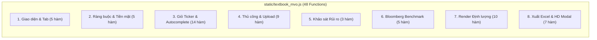

# 03. Frontend UI Sync & Test Playbook

> [!IMPORTANT]
> **Mục đích của tài liệu**: Cung cấp bản đồ ánh xạ chi tiết giữa **Backend JSON Response** và **Giao diện Người dùng (Frontend UI DOM Elements & Plotly Traces)**, cùng với **Kịch bản Kiểm thử Đầu-Cuối (End-to-End Testing Playbook)** giúp tester và lập trình viên kiểm chứng độ thông luồng 100% từ Database/Backend lên giao diện người dùng.
> **Tệp mã nguồn giao diện**: [`static/textbook_mvo.js`](file:///d:/Project%20Khim/portfolio-optimization-by-Khim-main/static/textbook_mvo.js) (1,901 dòng, 48 hàm) & [`templates/index.html`](file:///d:/Project%20Khim/portfolio-optimization-by-Khim-main/templates/index.html).

---

## 1. Danh Mục Toàn Bộ 48 Hàm JavaScript Theo 8 Cụm Chức Năng

Toàn bộ logic giao diện của ứng dụng được xây dựng theo kiến trúc Single Page Application (SPA), không sử dụng framework cồng kềnh mà dùng Vanilla JavaScript hiệu năng cao kết hợp với Plotly.js.



### Cụm 1: Quản lý Giao diện Sáng/Tối & Chuyển Tab (5 hàm)
1. `isDarkMode()` ([L39](file:///d:/Project%20Khim/portfolio-optimization-by-Khim-main/static/textbook_mvo.js#L39)): Kiểm tra xem thẻ `<html>` có chứa class `dark` hay không.
2. `initTheme()` ([L43](file:///d:/Project%20Khim/portfolio-optimization-by-Khim-main/static/textbook_mvo.js#L43)): Đọc `localStorage('mvo_theme')`, mặc định chế độ Light Mode phong cách Swiss Minimalist.
3. `toggleTheme()` ([L56](file:///d:/Project%20Khim/portfolio-optimization-by-Khim-main/static/textbook_mvo.js#L56)): Chuyển đổi qua lại giữa Light và Dark mode, lưu vào `localStorage`, đồng thời tự động re-render lại 3 biểu đồ Plotly theo bảng màu tương ứng.
4. `updateThemeIcons()` ([L73](file:///d:/Project%20Khim/portfolio-optimization-by-Khim-main/static/textbook_mvo.js#L73)): Ẩn/hiện icon Mặt trời (`#icon-theme-sun`) và Mặt trăng (`#icon-theme-moon`).
5. `switchLowerTab(tabName)` ([L84](file:///d:/Project%20Khim/portfolio-optimization-by-Khim-main/static/textbook_mvo.js#L84)): Chuyển đổi giữa 5 tab phân tích cấp dưới: `execution`, `benchmark`, `stress`, `moments`, `algebra`. Tự động kích hoạt `Plotly.Plots.resize` khi mở tab benchmark.

### Cụm 2: Ràng buộc Trọng số TT98 & Chế độ Tiền mặt (5 hàm)
6. `toggleTT98Preset(checked)` ([L101](file:///d:/Project%20Khim/portfolio-optimization-by-Khim-main/static/textbook_mvo.js#L101)): Bật/tắt nhanh trần tỷ trọng $20\%$ theo Thông tư 98/2020/TT-BTC áp dụng cho các quỹ mở tại Việt Nam ($w_{\min} = 0\%, w_{\max} = 20\%$).
7. `onWeightBoundSliderChange(triggerRun)` ([L113](file:///d:/Project%20Khim/portfolio-optimization-by-Khim-main/static/textbook_mvo.js#L113)): Đồng bộ thanh trượt `$rng-w-min`, `$rng-w-max` với các nhãn hiển thị và kích hoạt tính toán nếu có cờ `triggerRun`.
8. `setCashMode(mode)` ([L132](file:///d:/Project%20Khim/portfolio-optimization-by-Khim-main/static/textbook_mvo.js#L132)): Chuyển đổi giữa 2 chế độ tiền mặt: `bkm` (mô hình Bodie-Kane-Marcus tự tối ưu trọng số $y^*$ theo hàm hữu dụng) và `mandated` (người dùng chỉ định tỷ lệ tiền mặt cố định).
9. `syncMandatedCashInput(val)` ([L147](file:///d:/Project%20Khim/portfolio-optimization-by-Khim-main/static/textbook_mvo.js#L147)): Đồng bộ ô nhập liệu tiền mặt với thanh trượt.
10. `syncMandatedCashSlider(val)` ([L155](file:///d:/Project%20Khim/portfolio-optimization-by-Khim-main/static/textbook_mvo.js#L155)): Đồng bộ thanh trượt tiền mặt với ô nhập liệu.

### Cụm 3: Quản lý Giỏ Cổ phiếu & Tìm kiếm Autocomplete (14 hàm)
11. `bindUIEvents()` ([L162](file:///d:/Project%20Khim/portfolio-optimization-by-Khim-main/static/textbook_mvo.js#L162)): Đăng ký toàn bộ event listeners (thanh trượt rủi ro $A$, checkbox bán khống, phím điều hướng dropdown, upload file, hotkey Escape đóng modal).
12. `loadPresets()` ([L254](file:///d:/Project%20Khim/portfolio-optimization-by-Khim-main/static/textbook_mvo.js#L254)): Gọi `GET /api/presets` nạp danh bạ 159 cổ phiếu và bộ câu hỏi khảo sát rủi ro vào bộ nhớ trình duyệt.
13. `getHayInsightsSymbolList()` ([L271](file:///d:/Project%20Khim/portfolio-optimization-by-Khim-main/static/textbook_mvo.js#L271)): Trả về mảng các mã cổ phiếu đang được chọn.
14. `syncBasketUI()` ([L275](file:///d:/Project%20Khim/portfolio-optimization-by-Khim-main/static/textbook_mvo.js#L275)): Cập nhật nhãn đếm số lượng tài sản và vẽ lại các thẻ Ticker Pills.
15. `applyQuickBasket(syms)` ([L284](file:///d:/Project%20Khim/portfolio-optimization-by-Khim-main/static/textbook_mvo.js#L284)): Áp dụng danh mục mẫu nhanh (ví dụ: VN30 Core, Bank, Tech) và tự động chạy tối ưu hóa.
16. `addTickerToBasket(sym)` ([L290](file:///d:/Project%20Khim/portfolio-optimization-by-Khim-main/static/textbook_mvo.js#L290)): Thêm 1 mã cổ phiếu vào giỏ và gọi lấy giá live.
17. `removeTickerFromBasket(sym)` ([L300](file:///d:/Project%20Khim/portfolio-optimization-by-Khim-main/static/textbook_mvo.js#L300)): Xóa mã khỏi giỏ (ràng buộc tối thiểu 2 tài sản).
18. `fetchLiveQuoteForPill(sym)` ([L309](file:///d:/Project%20Khim/portfolio-optimization-by-Khim-main/static/textbook_mvo.js#L309)): Gọi `GET /api/hayinsights/quote/{symbol}` cập nhật thị giá vào thẻ Pill.
19. `renderSelectedTickerPills()` ([L329](file:///d:/Project%20Khim/portfolio-optimization-by-Khim-main/static/textbook_mvo.js#L329)): Render danh sách các thẻ Ticker Pill trong khung `#selected-ticker-pills`.
20. `searchLocalTickerDirectory(query)` ([L357](file:///d:/Project%20Khim/portfolio-optimization-by-Khim-main/static/textbook_mvo.js#L357)): Thuật toán tìm kiếm mã 4 lớp (Exact, Prefix, Sub-symbol, Sub-metadata).
21. `highlightMatch(text, query)` ([L396](file:///d:/Project%20Khim/portfolio-optimization-by-Khim-main/static/textbook_mvo.js#L396)): Làm nổi bật (highlight underline) ký tự trùng khớp.
22. `openTickerDropdown(query)` ([L402](file:///d:/Project%20Khim/portfolio-optimization-by-Khim-main/static/textbook_mvo.js#L402)): Mở menu thả xuống autocomplete.
23. `closeTickerDropdown()` ([L411](file:///d:/Project%20Khim/portfolio-optimization-by-Khim-main/static/textbook_mvo.js#L411)): Đóng menu thả xuống.
24. `renderTickerDropdownItems(query)` ([L417](file:///d:/Project%20Khim/portfolio-optimization-by-Khim-main/static/textbook_mvo.js#L417)): Render các dòng kết quả tìm kiếm kèm nhãn sàn, ngành và trạng thái `Added` / `+ Add`.
25. `handleDropdownSelectTicker(sym)` ([L463](file:///d:/Project%20Khim/portfolio-optimization-by-Khim-main/static/textbook_mvo.js#L463)): Thêm/bớt mã khi click vào dropdown.
26. `handleTickerSearchKeydown(e)` ([L478](file:///d:/Project%20Khim/portfolio-optimization-by-Khim-main/static/textbook_mvo.js#L478)): Điều hướng dropdown bằng bàn phím (ArrowUp, ArrowDown, Enter, Escape).
27. `scrollDropdownToHighlight()` ([L517](file:///d:/Project%20Khim/portfolio-optimization-by-Khim-main/static/textbook_mvo.js#L517)): Tự động cuộn thanh cuộn tới phần tử đang được chọn.

### Cụm 4: Chế độ Nhập liệu Thủ công & Upload File Excel (9 hàm)
28. `setInputMode(mode)` ([L524](file:///d:/Project%20Khim/portfolio-optimization-by-Khim-main/static/textbook_mvo.js#L524)): Chuyển đổi giữa chế độ `hayinsights` (Live API) và `manual` (Ma trận thủ công).
29. `updateAssetCountBadge()` ([L542](file:///d:/Project%20Khim/portfolio-optimization-by-Khim-main/static/textbook_mvo.js#L542)): Cập nhật số lượng tài sản lên huy hiệu giao diện.
30. `renderManualTable()` ([L551](file:///d:/Project%20Khim/portfolio-optimization-by-Khim-main/static/textbook_mvo.js#L551)): Vẽ bảng ma trận tương quan và lợi suất thủ công $N \times N$.
31. `updateManualSymbol(idx, val)` ([L581](file:///d:/Project%20Khim/portfolio-optimization-by-Khim-main/static/textbook_mvo.js#L581)): Đổi tên mã tài sản trong ma trận thủ công.
32. `updateManualER(idx, val)` ([L585](file:///d:/Project%20Khim/portfolio-optimization-by-Khim-main/static/textbook_mvo.js#L585)): Đổi kỳ vọng lợi suất $E(R)$.
33. `updateManualStd(idx, val)` ([L588](file:///d:/Project%20Khim/portfolio-optimization-by-Khim-main/static/textbook_mvo.js#L588)): Đổi độ lệch chuẩn rủi ro $\sigma$.
34. `updateManualCorr(i, j, val)` ([L591](file:///d:/Project%20Khim/portfolio-optimization-by-Khim-main/static/textbook_mvo.js#L591)): Đổi hệ số tương quan đối xứng $\rho_{i,j} = \rho_{j,i}$.
35. `addManualAssetRow()` ([L598](file:///d:/Project%20Khim/portfolio-optimization-by-Khim-main/static/textbook_mvo.js#L598)): Thêm dòng tài sản mới (tối đa 10 tài sản).
36. `removeManualAssetRow()` ([L613](file:///d:/Project%20Khim/portfolio-optimization-by-Khim-main/static/textbook_mvo.js#L613)): Xóa bớt dòng tài sản (tối thiểu 2 tài sản).
37. `handleExcelUpload(e)` ([L623](file:///d:/Project%20Khim/portfolio-optimization-by-Khim-main/static/textbook_mvo.js#L623)): Gửi file Excel lên `POST /api/upload-excel`, cập nhật trạng thái và tự động chạy tối ưu hóa.

### Cụm 5: Trắc nghiệm Khẩu vị Rủi ro (3 hàm)
38. `renderQuizQuestions()` ([L650](file:///d:/Project%20Khim/portfolio-optimization-by-Khim-main/static/textbook_mvo.js#L650)): Render 4 câu hỏi trắc nghiệm vào modal `#quiz-questions-container`.
39. `toggleQuizModal()` ([L671](file:///d:/Project%20Khim/portfolio-optimization-by-Khim-main/static/textbook_mvo.js#L671)): Mở/đóng cửa sổ khảo sát rủi ro.
40. `submitRiskQuiz()` ([L676](file:///d:/Project%20Khim/portfolio-optimization-by-Khim-main/static/textbook_mvo.js#L676)): Thu thập câu trả lời, gửi `POST /api/quiz`, cập nhật hệ số ngại rủi ro $A$ lên giao diện và chạy lại tối ưu hóa.

### Cụm 6: Điều khiển Chuẩn So sánh Bloomberg-Style (5 hàm)
41. `updateBenchmarkPillsUI()` ([L708](file:///d:/Project%20Khim/portfolio-optimization-by-Khim-main/static/textbook_mvo.js#L708)): Làm nổi bật nút kỳ hạn (`6m`, `1y`, `3y`, `5y`, `ytd`, `max`) và chỉ số (`VNINDEX`, `VN30`) đang chọn.
42. `setBenchmarkHorizon(horizon)` ([L747](file:///d:/Project%20Khim/portfolio-optimization-by-Khim-main/static/textbook_mvo.js#L747)): Đổi kỳ hạn benchmark và kích hoạt tính lại attribution nhanh.
43. `setBenchmarkIndex(symbol)` ([L759](file:///d:/Project%20Khim/portfolio-optimization-by-Khim-main/static/textbook_mvo.js#L759)): Đổi chỉ số chuẩn so sánh (`VNINDEX` hoặc `VN30`).
44. `onBenchmarkConfigChange(newSym, newHorizon)` ([L771](file:///d:/Project%20Khim/portfolio-optimization-by-Khim-main/static/textbook_mvo.js#L771)): Xử lý sự kiện thay đổi từ menu select box.
45. `runBenchmarkAttributionRecalc()` ([L783](file:///d:/Project%20Khim/portfolio-optimization-by-Khim-main/static/textbook_mvo.js#L783)): Gửi yêu cầu `POST /api/benchmark-attribution` để tính lại attribution trong ~50ms mà không cần giải lại bài toán QP.

### Cụm 7: Thực thi Tối ưu hóa & 8 Bộ Render Giao diện (10 hàm)
46. `buildRequestPayload()` ([L831](file:///d:/Project%20Khim/portfolio-optimization-by-Khim-main/static/textbook_mvo.js#L831)): Đóng gói toàn bộ tham số từ form giao diện thành đối tượng JSON gửi lên API.
47. `runMVOOptimization()` ([L880](file:///d:/Project%20Khim/portfolio-optimization-by-Khim-main/static/textbook_mvo.js#L880)): **Hàm điều phối trung tâm Frontend**. Gửi `POST /api/optimize` và phân phối kết quả trả về cho 8 hàm render bên dưới.
48. `renderKPISummary(data)` ([L955](file:///d:/Project%20Khim/portfolio-optimization-by-Khim-main/static/textbook_mvo.js#L955)): Điền các thẻ KPI tổng quan (Lợi suất, Độ biến động, Phương sai, Sharpe) cho 3 danh mục: Tangency, GMV, và Complete Portfolio.
49. `getChartThemeTokens()` ([L981](file:///d:/Project%20Khim/portfolio-optimization-by-Khim-main/static/textbook_mvo.js#L981)): Cung cấp mã màu HEX tương thích với chế độ sáng/tối cho Plotly.
50. `renderPlotlyFrontier(data)` ([L997](file:///d:/Project%20Khim/portfolio-optimization-by-Khim-main/static/textbook_mvo.js#L997)): Vẽ biểu đồ phân tán và đường cong Đường biên hiệu quả gồm 9 traces (Monte Carlo, Frontier, CAL, Indifference Curve, Individual Assets, GMV, Tangency, Complete, Benchmark Point).
51. `renderPlotlyWeights(data)` ([L1158](file:///d:/Project%20Khim/portfolio-optimization-by-Khim-main/static/textbook_mvo.js#L1158)): Vẽ biểu đồ cột nhóm so sánh phân bổ tỷ trọng giữa GMV, Tangency và Complete Portfolio.
52. `renderWeightsAndLot100Table(data)` ([L1215](file:///d:/Project%20Khim/portfolio-optimization-by-Khim-main/static/textbook_mvo.js#L1215)): Vẽ bảng thực thi giao dịch chi tiết làm tròn Lô 100 theo luật Việt Nam, phí môi giới 0.15%, thuế bán 0.10%, và dòng tiền mặt dự phòng.
53. `renderBenchmarkTab(data)` ([L1317](file:///d:/Project%20Khim/portfolio-optimization-by-Khim-main/static/textbook_mvo.js#L1317)): Render dải 5 thẻ KPI kiểu Bloomberg (Alpha, Beta, Information Ratio, Tracking Error, R²), bảng đối chuẩn, và biểu đồ tài sản tích lũy Base 100.
54. `renderStressTestingTab(data)` ([L1502](file:///d:/Project%20Khim/portfolio-optimization-by-Khim-main/static/textbook_mvo.js#L1502)): Điền 4 thẻ rủi ro đuôi (1D VaR, 1D CVaR, 1M VaR, MDD) và bảng mô phỏng 4 kịch bản khủng hoảng.
55. `renderMatricesTables(data)` ([L1569](file:///d:/Project%20Khim/portfolio-optimization-by-Khim-main/static/textbook_mvo.js#L1569)): Điền 3 bảng thống kê tài sản riêng lẻ, ma trận tương quan $\mathbf{C}$ và ma trận hiệp phương sai $\boldsymbol{\Sigma}$.
56. `renderAlgebraStepByStep(data)` ([L1626](file:///d:/Project%20Khim/portfolio-optimization-by-Khim-main/static/textbook_mvo.js#L1626)): Điền bảng nghịch đảo $\boldsymbol{\Sigma}^{-1}$, 4 vô hướng Merton $A, B, C, D$ và công thức toán học từng bước.

### Cụm 8: Kết xuất Báo cáo Excel & Phóng to Biểu đồ HD (7 hàm)
57. `_getTodayDateTag()` ([L1674](file:///d:/Project%20Khim/portfolio-optimization-by-Khim-main/static/textbook_mvo.js#L1674)): Trả về chuỗi ngày dạng `YYYYMMDD` để đặt tên file xuất.
58. `exportCurrentPriceData()` ([L1682](file:///d:/Project%20Khim/portfolio-optimization-by-Khim-main/static/textbook_mvo.js#L1682)): Tải file Excel dữ liệu giá lịch sử 4 sheets.
59. `exportCurrentMatrixData()` ([L1723](file:///d:/Project%20Khim/portfolio-optimization-by-Khim-main/static/textbook_mvo.js#L1723)): Tải file Excel ma trận tham số 3 sheets.
60. `exportInstitutionalExcel()` ([L1763](file:///d:/Project%20Khim/portfolio-optimization-by-Khim-main/static/textbook_mvo.js#L1763)): Tải báo cáo định chế toàn diện 8 sheets.
61. `openChartFullscreen(chartKey)` ([L1800](file:///d:/Project%20Khim/portfolio-optimization-by-Khim-main/static/textbook_mvo.js#L1800)): Mở modal phóng to toàn màn hình biểu đồ độ nét cao (Frontier, Weights, hoặc Benchmark).
62. `closeChartFullscreen()` ([L1866](file:///d:/Project%20Khim/portfolio-optimization-by-Khim-main/static/textbook_mvo.js#L1866)): Đóng modal phóng to biểu đồ.
63. `resetFullscreenChartPlot()` ([L1883](file:///d:/Project%20Khim/portfolio-optimization-by-Khim-main/static/textbook_mvo.js#L1883)): Khôi phục tỷ lệ trục biểu đồ tự động (`autorange`).

---

## 2. Bản Đồ Ánh Xạ JSON Backend $\rightarrow$ DOM ID / Plotly Trace

Bảng đối chiếu dưới đây là tài liệu cốt lõi phục vụ kiểm thử tính toàn vẹn dữ liệu:

| Phân Vùng UI | Trường Dữ Liệu Backend (`data`) | ID Phần Tử DOM / Trace Plotly | Định Dạng Hiển Thị Trên UI |
| :--- | :--- | :--- | :--- |
| **Header Status** | `data_meta.from_date`, `data_meta.to_date`, `sessions_count` | `#lbl-data-source-tag` | `2023-11-10 → 2024-11-08 (250d)` |
| **Bounds Note** | `bounds_adjusted_note` | `#box-bounds-note` | Cảnh báo nới biên vàng (ẩn nếu không có) |
| **Chart Label** | `allow_short`, `w_min`, `w_max` | `#chart-mode-label` | `Bounded QP (0% ≤ wi ≤ 20%)` hoặc `Closed-Form` |
| **KPI Tangency** | `tangency.expected_return` | `#kpi-tan-ret` | Tỷ lệ phần trăm (e.g. `24.50%`) |
| | `tangency.volatility` | `#kpi-tan-vol` | Tỷ lệ phần trăm (e.g. `16.20%`) |
| | `tangency.variance` | `#kpi-tan-var` | Số thực 4 chữ số (e.g. `0.0262`) |
| | `tangency.sharpe_ratio` | `#kpi-tan-sr` | Số thực 3 chữ số (e.g. `1.235`) |
| **KPI GMV** | `gmv.expected_return` | `#kpi-gmv-ret` | Tỷ lệ phần trăm (e.g. `14.80%`) |
| | `gmv.volatility` | `#kpi-gmv-vol` | Tỷ lệ phần trăm (e.g. `11.50%`) |
| | `gmv.variance` | `#kpi-gmv-var` | Số thực 4 chữ số (e.g. `0.0132`) |
| | `gmv.sharpe_ratio` | `#kpi-gmv-sr` | Số thực 3 chữ số (e.g. `0.895`) |
| **KPI Complete** | `complete_portfolio.y_star_risky_weight` | `#kpi-comp-y` | Trọng số tài sản rủi ro (e.g. `65.4%`) |
| | `complete_portfolio.w_rf_weight` | `#kpi-comp-rfw` | Trọng số tiền mặt/phi rủi ro (e.g. `34.6%`) |
| | `complete_portfolio.expected_return` | `#kpi-comp-ret` | Tỷ lệ phần trăm lợi suất danh mục C |
| | `complete_portfolio.volatility` | `#kpi-comp-vol` | Tỷ lệ phần trăm rủi ro danh mục C |
| | `complete_portfolio.utility_score` | `#kpi-comp-u` | Điểm số hữu dụng $U^*$ |
| **Biểu đồ Frontier** | `monte_carlo` (2,500 điểm) | Plotly trace 0 (`scattergl`) | Đám mây màu YlGnBu / Blues |
| | `frontier` (tọa độ $\sigma, E(R)$) | Plotly trace 1 (`scatter`) | Đường cong màu Navy `#2563eb` |
| | `complete_portfolio.cal_line` | Plotly trace 2 (`scatter`) | Đường nét đứt màu Amber `#f59e0b` |
| | `complete_portfolio.indifference_curve`| Plotly trace 3 (`scatter`) | Đường chấm bi màu Tím `#a855f7` |
| | `individual_assets` | Plotly trace 4 (`scatter+text`) | Điểm xám kèm mã cổ phiếu |
| | `gmv` | Plotly trace 5 (`diamond`) | Điểm hình thoi màu Hổ phách |
| | `tangency` | Plotly trace 6 (`circle`) | Điểm tròn màu Ngọc lục bảo `#10b981` |
| | `complete_portfolio` | Plotly trace 7 (`square`) | Điểm hình vuông màu Tím |
| | `benchmark_comparison` | Plotly trace 8 (`star`) | Ngôi sao màu Đỏ hồng `#f43f5e` |
| **Bảng Lô 100** | `symbols`, `latest_prices`, `nav_vnd`, `tangency.weights`, `complete_portfolio.asset_weights` | `#tbl-weights-lot100` | Bảng HTML chia cột: Target Value, Lot-100 Shares, Actual Executed Value, Phí 0.15%, Thuế 0.10% |
| | Tiền mặt dự phòng dư | `#lbl-execution-summary` | `Equities: X VND · Cash Reserve: Y VND (Z%)` |
| **Benchmark Strip**| `benchmark_comparison.active_return` | `#bm-kpi-alpha`, `#bm-kpi-bps` | Độ chênh lợi suất (e.g. `+8.45%`, `+845 bps`) |
| | `benchmark_comparison.beta` | `#bm-kpi-beta`, `#bm-kpi-beta-tag` | Hệ số Beta (e.g. `0.920`, `Defensive`) |
| | `benchmark_comparison.information_ratio`| `#bm-kpi-ir`, `#bm-kpi-ir-tag` | Tỷ số IR (e.g. `1.15`, `Exceptional`) |
| | `benchmark_comparison.tracking_error` | `#bm-kpi-te` | Sai lệch theo dõi (e.g. `7.35%`) |
| | `benchmark_comparison.correlation`, `r_squared` | `#bm-kpi-corr`, `#bm-kpi-r2` | Tương quan $\rho$ và $R^2$ |
| | `benchmark_comparison.cumulative_series` | `#chart-benchmark-cum` | Biểu đồ đường tài sản tích lũy (Base 100) |
| **Stress & VaR** | `stress_testing.var_metrics` | `#stress-var-cards` | 4 thẻ: 1D VaR 95%, 1D CVaR 95%, 1M VaR 95%, MDD |
| | `stress_testing.scenarios` | `#tbl-stress-scenarios` | Bảng 4 dòng kịch bản khủng hoảng |
| **Moments Tab** | `individual_assets`, `corr`, `cov` | `#tbl-asset-stats`, `#tbl-corr-matrix`, `#tbl-cov-matrix` | 3 bảng ma trận thống kê |
| **Algebra Tab** | `inv_cov`, `merton_scalars` ($A, B, C, D$) | `#tbl-invcov-matrix`, `#merton-scalars-box`, `#merton-formulas-note` | Bảng ma trận nghịch đảo và khối 4 vô hướng Merton |

---

## 3. Kịch Bản Kiểm Thử Đầu-Cuối (End-to-End Testing Playbook)

Thực hiện tuần tự 8 ca kiểm thử sau để kiểm chứng toàn bộ luồng hoạt động từ Cơ sở Dữ liệu đến Giao diện:

### Ca 1: Kiểm thử Đồng bộ Dữ liệu Thực từ API vào Database & Báo giá Live Pill
1. **Mục tiêu**: Kiểm tra xem việc đồng bộ qua API có nạp đúng dữ liệu vào SQLite và hiển thị giá ngay lên các thẻ Ticker Pill ở UI hay không.
2. **Thao tác**:
   - Mở terminal, gọi đồng bộ mã `FPT` và `MWG`:
     ```powershell
     Invoke-RestMethod -Method Post -Uri "http://localhost:8000/api/db/sync/equity/FPT"
     Invoke-RestMethod -Method Post -Uri "http://localhost:8000/api/db/sync/equity/MWG"
     ```
   - Mở trình duyệt tại `http://localhost:8000`.
   - Quan sát khung Ticker Pills bên trái.
3. **Kết quả mong đợi (Pass Criteria)**:
   - Thẻ `FPT` hiển thị giá đóng cửa thực tế (ví dụ: `114.500`), thẻ `MWG` hiển thị giá thực tế (ví dụ: `65.200`).
   - Gọi `GET /api/db/stats` thấy `fact_equity_daily_prices` tăng số dòng tương ứng.

### Ca 2: Kiểm thử Chạy Tối ưu hóa Markowitz & Render Plotly
1. **Mục tiêu**: Kiểm tra tính toán MVO và việc vẽ biểu đồ Efficient Frontier, CAL, Indifference Curve.
2. **Thao tác**:
   - Chọn giỏ 5 cổ phiếu mặc định: `FPT, MWG, VCB, HPG, VNM`.
   - Nhấn nút **"Run Textbook MVO Optimization"** (`#btn-run-mvo`).
3. **Kết quả mong đợi (Pass Criteria)**:
   - Nút chuyển trạng thái loading *"Computing Optimization..."* rồi trả về bình thường.
   - 4 thẻ KPI hiển thị đầy đủ số liệu cho Tangency, GMV và Complete Portfolio.
   - Biểu đồ `#chart-frontier` hiển thị đầy đủ: Đám mây 2,500 điểm Monte Carlo, đường cong biên hiệu quả màu xanh, đường CAL màu vàng nét đứt nối từ điểm $R_f$ qua điểm Tangency, và đường bàng quan hữu dụng màu tím.
   - Bảng `#tbl-weights-lot100` hiển thị số cổ phiếu được làm tròn chính xác theo bội số của 100, kèm phí 0.15% và thuế 0.10%.

### Ca 3: Kiểm thử Đổi Kỳ hạn Benchmark Tức thời (Bloomberg Strip)
1. **Mục tiêu**: Kiểm tra tính năng đổi kỳ hạn so sánh chuẩn chỉ số mà không làm treo hay gián đoạn giao diện.
2. **Thao tác**:
   - Chuyển sang tab **"Benchmark Comparison"** (`#tab-btn-benchmark`).
   - Click lần lượt vào các nút kỳ hạn: `6M`, `1Y`, `3Y`, `5Y`, `YTD`, `MAX`.
   - Click chuyển đổi giữa 2 chỉ số: `VN-Index` và `VN30`.
3. **Kết quả mong đợi (Pass Criteria)**:
   - Biểu tượng spinner `#bm-attribution-spinner` xuất hiện và biến mất trong vòng dưới 100ms.
   - Dải 5 thẻ KPI kiểu Bloomberg tự động nhảy số: Alpha Jensen, Beta, IR, Tracking Error.
   - Biểu đồ `#chart-benchmark-cum` cập nhật lại chuỗi tài sản tích lũy Base 100 tương ứng với khoảng ngày vừa chọn.

### Ca 4: Kiểm thử Khảo sát Khẩu vị Rủi ro & Tự Động Tái Tối Ưu Hóa
1. **Mục tiêu**: Kiểm tra luồng tính điểm trắc nghiệm và truyền hệ số $A$ vào hàm phân bổ vốn $C$.
2. **Thao tác**:
   - Click nút **"Assess Risk Profile"** để mở modal trắc nghiệm.
   - Chọn đáp án có mức độ rủi ro cao nhất cho cả 4 câu (điểm 4/4 mỗi câu).
   - Nhấn **"Calculate Risk Aversion & Apply"**.
3. **Kết quả mong đợi (Pass Criteria)**:
   - Modal tự động đóng.
   - Thanh trượt hệ số ngại rủi ro `#rng-risk-a` tự động nhảy về giá trị $A = 1.2$ (Aggressive).
   - Huy hiệu `#quiz-profile-badge` hiển thị `Aggressive (A = 1.2)`.
   - Hệ thống tự động kích hoạt lại `runMVOOptimization()`, tỷ trọng tài sản rủi ro $y^*$ tăng lên phản ánh khẩu vị chấp nhận rủi ro cao.

### Ca 5: Kiểm thử Khống chế Trần Tỷ trọng Thông tư 98 (TT98 Cap)
1. **Mục tiêu**: Kiểm tra ràng buộc pháp lý $w_i \le 20\%$ của quỹ mở Việt Nam.
2. **Thao tác**:
   - Đánh dấu vào checkbox **"Circular 98 Cap (max 20% / asset)"** (`#chk-tt98-cap`).
   - Quan sát thanh trượt `$rng-w-max` nhảy về `20%`.
   - Nhấn chạy tối ưu hóa.
3. **Kết quả mong đợi (Pass Criteria)**:
   - Toàn bộ các trọng số trong danh mục Tangency và Complete Portfolio ở bảng `#tbl-weights-lot100` đều $\le 20.00\%$.
   - Nếu tổng số tài sản $N < 5$ (không thể phân bổ tối đa 20% cho mỗi mã), hệ thống hiển thị thông báo nới biên màu vàng tại `#box-bounds-note`.

### Ca 6: Kiểm thử Upload File Excel Chế độ Ma trận (Mode A) và Chuỗi giá (Mode B)
1. **Mục tiêu**: Kiểm tra tính năng Round-trip tương thích ngược 100% của bộ nạp Excel.
2. **Thao tác**:
   - Nhấn nút **"Download Excel Template"** tải file mẫu về máy.
   - Nhập một số liệu tùy chỉnh rồi tải lên qua ô `#inp-excel-upload`.
3. **Kết quả mong đợi (Pass Criteria)**:
   - Giao diện tự động chuyển sang chế độ Manual hoặc hiển thị tên file tải lên tại nhãn `#lbl-data-source-tag`.
   - Bảng tham số `#manual-param-table` được điền chính xác số liệu từ file Excel.
   - Tối ưu hóa tự động chạy và trả về kết quả hợp lệ mà không phát sinh lỗi ma trận suy biến.

### Ca 7: Kiểm thử Xuất Báo cáo Định chế Excel 8 Sheets
1. **Mục tiêu**: Kiểm tra việc sinh workbook Excel chuẩn Institutional Edition với công thức sống.
2. **Thao tác**:
   - Nhấn nút **"Export Institutional Excel"** (`#btn-export-excel`).
   - Mở file `.xlsx` vừa tải về bằng Microsoft Excel.
3. **Kết quả mong đợi (Pass Criteria)**:
   - File mở không bị cảnh báo corrupt hay repaired.
   - Đủ 8 sheets theo đúng danh mục: `01_Executive_Summary` đến `08_Historical_Prices`.
   - Tại sheet `03_Matrix_Algebra_Merton`, các ô chứa công thức sống `=MMULT(...)`, `=MINVERSE(...)`.
   - Tại sheet `06_VN_Lot100_Execution`, cột Lot 100 chứa công thức sống `=FLOOR(..., 100)`.
   - Sheet `05_Efficient_Frontier` chứa biểu đồ Scatter Chart nhúng sẵn.

### Ca 8: Kiểm thử Phóng to Biểu đồ HD Toàn màn hình (Fullscreen Modal)
1. **Mục tiêu**: Kiểm tra tính năng xem chi tiết biểu đồ độ nét cao phục vụ thuyết trình / báo cáo.
2. **Thao tác**:
   - Click nút phóng to trên biểu đồ Efficient Frontier (`openChartFullscreen('frontier')`).
   - Sử dụng các công cụ zoom/pan của Plotly trong modal.
   - Nhấn phím `Escape` trên bàn phím.
3. **Kết quả mong đợi (Pass Criteria)**:
   - Cửa sổ modal `#modal-chart-fullscreen` mở ra toàn màn hình, biểu đồ được tự động căn chỉnh kích thước (autosize) với font chữ rõ nét.
   - Khi nhấn `Escape`, modal đóng mượt mà và 3 biểu đồ ở trang chính tự động resize lại đúng kích thước cột ban đầu.

---

> [!NOTE]
> Bộ tài liệu hoàn chỉnh bao gồm 4 phần:
> 1. [00. Master Architecture & Graphify Knowledge Map](file:///d:/Project%20Khim/portfolio-optimization-by-Khim-main/docs/00_MASTER_ARCHITECTURE_AND_GRAPHIFY_MAP.md)
> 2. [01. Backend Python Functions Reference](file:///d:/Project%20Khim/portfolio-optimization-by-Khim-main/docs/01_BACKEND_PYTHON_FUNCTIONS_REFERENCE.md)
> 3. [02. Database & External API Flows](file:///d:/Project%20Khim/portfolio-optimization-by-Khim-main/docs/02_DATABASE_AND_EXTERNAL_API_FLOWS.md)
> 4. [03. Frontend UI Sync & Test Playbook](file:///d:/Project%20Khim/portfolio-optimization-by-Khim-main/docs/03_FRONTEND_UI_SYNC_AND_TEST_PLAYBOOK.md)

