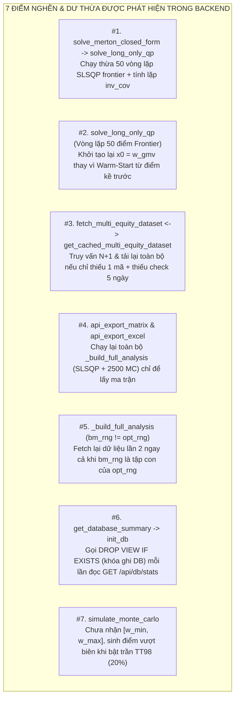
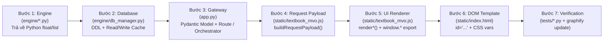

# 04. Kiểm Toán Kiến Trúc Chuyên Sâu, Tối Ưu Hóa & Quy Trình Chuẩn Phát Triển Hệ Thống (System Audit & Engineering SOP)

> [!IMPORTANT]
> Tài liệu này được xây dựng dựa trên kết quả kiểm toán từng dòng lệnh (Line-by-Line Code Audit) kết hợp với đồ thị tri thức **Graphify AST (429 nodes, 916 edges)** của toàn bộ hệ thống **Portfolio Optimization by Khim (v2.4)**.
> Nội dung giải quyết trọn vẹn 4 trọng tâm:
> 1. **Kiểm toán liên kết giữa các hàm Backend**: Chỉ rõ các liên kết kém hiệu quả, các đoạn mã dư thừa (redundant) và giải pháp tối ưu hóa cụ thể.
> 2. **Kiểm toán đường nối Backend $\leftrightarrow$ Frontend UI**: Đánh giá hiệu năng truyền tải và các lỗi thực tế người dùng có thể gặp phải.
> 3. **Dự báo lỗi hệ thống theo luồng thông tin & Phương án nâng cấp**: Phân tích rủi ro tiềm ẩn kèm đánh giá phạm vi ảnh hưởng (**Blast Radius**) tới các hàm liên quan.
> 4. **Quy trình chuẩn (Standard Operating Procedures — SOP)**: Cẩm nang từng bước để tích hợp hàm mới từ Backend lên Frontend và danh mục các điểm bắt buộc phải chỉnh sửa song song khi Thêm / Sửa / Xóa tính năng trong tương lai.

---

## Phần 1: Kiểm Toán Liên Kết Các Functions Backend — Phát Hiện Dư Thừa (Redundancy) & Phương Án Tối Ưu Hóa

Khi đối chiếu đồ thị gọi hàm từ [`_build_full_analysis()`](file:///d:/Project%20Khim/portfolio-optimization-by-Khim-main/app.py#L103-L285) xuống 9 module trong `engine/*.py`, có **7 điểm nghẽn / dư thừa** đã được xác định chính xác tới từng dòng code:



### 1.1. Redundancy #1: Tính lặp `inv_cov` + Vô hướng Merton và chạy thừa 50 bài toán SLSQP khi Fallback
- **Vị trí liên kết**: [`textbook_math.solve_merton_closed_form()`](file:///d:/Project%20Khim/portfolio-optimization-by-Khim-main/engine/textbook_math.py#L133-L162) $\longrightarrow$ [`textbook_math.solve_long_only_qp()`](file:///d:/Project%20Khim/portfolio-optimization-by-Khim-main/engine/textbook_math.py#L209-L365).
- **Hiện trạng kém hiệu quả**:
  1. Cả hai hàm `solve_merton_closed_form` (`L133-L141`) và `solve_long_only_qp` (`L355-L364`) đều viết lặp lại y hệt nhau 12 dòng code tính nghịch đảo ma trận `inv_cov = np.linalg.inv(cov)` và 4 vô hướng $A, B, C, D$.
  2. Nghiêm trọng hơn, tại [`textbook_math.py:L158-L161`](file:///d:/Project%20Khim/portfolio-optimization-by-Khim-main/engine/textbook_math.py#L158-L161):
     ```python
     if tan_stats["expected_return"] < gmv_stats["expected_return"] or tan_stats["sharpe_ratio"] < gmv_stats["sharpe_ratio"]:
         res_qp = solve_long_only_qp(mu, cov, rf, allow_short=True, num_frontier=num_frontier)
         w_tan = res_qp["w_tangency"]
         tan_stats = res_qp["tangency_stats"]
     ```
     Khi hệ số mẫu số $A - C \cdot R_f < 0$ (xảy ra khi lãi suất phi rủi ro $R_f > E(R_{\text{GMV}})$, khiến nghiệm tiếp tuyến giải tích rơi xuống nhánh dưới của đường hyperbol), `solve_merton_closed_form` gọi `solve_long_only_qp(..., num_frontier=50)`. Lệnh gọi này thực thi **52 bài toán tối ưu SLSQP** (`res_gmv`, `res_tan`, và 50 điểm `frontier`) cùng 1 lần nghịch đảo ma trận `inv_cov`, nhưng sau đó chỉ lấy đúng `w_tangency` và **vứt bỏ toàn bộ 50 điểm frontier vừa giải** (vì ngay bên dưới tại `L169-L182`, nó tự tính lại 50 điểm frontier bằng công thức giải tích $\mathbf{w}_p = \mathbf{g} + \mathbf{h} r_{\text{target}}$!).
- **Cách tối ưu hóa**:
  - Tách hàm dùng chung `_compute_merton_scalars(mu, cov) -> tuple[np.ndarray, dict[str, float]]`.
  - Khi `solve_merton_closed_form` cần fallback tìm `w_tangency` trên nhánh trên, truyền `num_frontier=0` vào `solve_long_only_qp` để chỉ chạy đúng **1 bài toán SLSQP** thay vì 52 bài toán (giảm ~95% thời gian CPU ở nhánh này).

### 1.2. Inefficiency #2: Thiếu cơ chế Khởi tạo Nóng (Continuation Warm-Start) trong vòng lặp 50 điểm Frontier
- **Vị trí liên kết**: [`textbook_math.solve_long_only_qp()`](file:///d:/Project%20Khim/portfolio-optimization-by-Khim-main/engine/textbook_math.py#L321-L344).
- **Hiện trạng kém hiệu quả**:
  - Vòng lặp `for r_t in target_rets:` giải 50 bài toán quy hoạch bậc hai SLSQP liên tiếp từ `min_r` đến `max_r`. Tuy nhiên, ở mọi vòng lặp thứ $k$, thuật toán luôn khởi tạo lại điểm xuất phát `x0 = w_gmv` (`L329`).
  - Khi `r_t` tiến gần về `max_r` (cách rất xa `w_gmv`), bộ giải SLSQP phải tốn nhiều bước lặp đạo hàm để đi từ `w_gmv` tới nghiệm biên.
- **Cách tối ưu hóa**:
  - Áp dụng **Homotopy / Continuation Warm-Starting**: Đặt `prev_w = w_gmv` trước vòng lặp; tại mỗi bước `r_t`, truyền `x0 = prev_w`, và nếu `res_f.success` thì cập nhật `prev_w = w_f`. Do hai điểm liền kề trên đường biên hiệu quả có vector trọng số cực kỳ sát nhau ($\|\mathbf{w}_k - \mathbf{w}_{k-1}\|_2 \ll 1$), SLSQP sẽ hội tụ chỉ sau 2–3 bước lặp thay vì 15–30 bước, giảm **50%–65% thời gian giải QP**.

### 1.3. Inefficiency #3: Truy vấn $N+1$, Tải lại toàn bộ khi thiếu 1 mã & Lệch chuẩn Freshness Check giữa Single và Multi-Equity
- **Vị trí liên kết**: [`hayinsights_client.fetch_multi_equity_dataset()`](file:///d:/Project%20Khim/portfolio-optimization-by-Khim-main/engine/hayinsights_client.py#L560-L615) $\longleftrightarrow$ [`db_manager.get_cached_multi_equity_dataset()`](file:///d:/Project%20Khim/portfolio-optimization-by-Khim-main/engine/db_manager.py#L749-L851) $\longleftrightarrow$ [`db_manager.get_single_equity_cached_payload()`](file:///d:/Project%20Khim/portfolio-optimization-by-Khim-main/engine/db_manager.py#L650-L746).
- **Hiện trạng kém hiệu quả (3 điểm)**:
  1. **Bất đồng bộ kiểm tra độ tươi mới (`> 5 ngày`)**: Trong `get_single_equity_cached_payload` (`L699-L704`), hệ thống kiểm tra `if (today - latest_dt).days > 5: return None`. Ngược lại, trong `get_cached_multi_equity_dataset` (`L795-L827`) và `get_benchmark_series_from_db` (`L905-L929`), **hoàn toàn không có dòng kiểm tra `(today - latest_dt).days > 5`**! Hệ quả là nếu DB có sẵn 200 phiên từ năm ngoái của 5 mã, `get_cached_multi_equity_dataset` sẽ trả về dữ liệu cũ mãi mãi mà không bao giờ tự động làm mới, trong khi gọi lẻ từng mã qua `fetch_single_equity` lại coi đó là dữ liệu hết hạn.
  2. **Đọc/Chuyển đổi dữ liệu lặp 2 lần khi giỏ có 1 mã mới**: Giả sử 4 mã `FPT, MWG, VCB, HPG` đã có trong SQLite, người dùng thêm 1 mã mới `SSI`. `get_cached_multi_equity_dataset` thấy thiếu `SSI` nên trả về `None` (bỏ toàn bộ 4 DataFrame vừa đọc). Sau đó `fetch_multi_equity_dataset` chạy `ThreadPoolExecutor` gọi `fetch_single_equity` cho cả 5 mã — khiến 4 mã cũ lại phải mở kết nối SQLite lần thứ 2 trong `get_single_equity_cached_payload`, ép kiểu từng dòng sang `list[dict]` JSON, rồi ra ngoài lại ép ngược từ `list[dict]` về `pd.DataFrame` tại `L595`!
  3. **Truy vấn $N+1$**: Trong `get_cached_multi_equity_dataset`, vòng lặp `for sym in clean_syms:` chạy $N$ câu `SELECT` rời rạc thay vì dùng hàm cửa sổ `ROW_NUMBER() OVER (PARTITION BY symbol ORDER BY trading_date DESC)`.
- **Cách tối ưu hóa**:
  - Bổ sung kiểm tra `(today - latest_dt).days <= 5` đồng nhất vào `get_cached_multi_equity_dataset` và `get_benchmark_series_from_db`.
  - Trong `fetch_multi_equity_dataset`: Nếu `get_cached_multi_equity_dataset` báo thiếu, chỉ gọi API cho **các mã thực sự thiếu/cũ**, để chúng tự động Write-Through vào SQLite, rồi gọi lại `get_cached_multi_equity_dataset` một lần duy nhất.

### 1.4. Redundancy #4: Chạy lại toàn bộ `_build_full_analysis` khi xuất Ma trận Tham số & Báo cáo Excel
- **Vị trí liên kết**: [`app.api_export_matrix()`](file:///d:/Project%20Khim/portfolio-optimization-by-Khim-main/app.py#L554-L581) và [`app.api_export_excel()`](file:///d:/Project%20Khim/portfolio-optimization-by-Khim-main/app.py#L584-L598) $\longrightarrow$ [`app._build_full_analysis()`](file:///d:/Project%20Khim/portfolio-optimization-by-Khim-main/app.py#L103-L285).
- **Hiện trạng kém hiệu quả**:
  - `api_export_matrix` chỉ cần xuất `mu`, `std`, `corr`, `cov`, `latest_prices` (tức chỉ cần bước tính Moments đầu tiên). Thế nhưng tại `app.py:L561`, nó gọi `_build_full_analysis(req)`, bắt máy chủ giải lại 52 bài toán SLSQP, chạy lại 2,500 kịch bản Monte Carlo, gọi lại VNDirect Benchmark và tính lại VaR/Stress Test — rồi **bỏ đi 90% kết quả vừa tính**!
  - Tương tự, ngay sau khi người dùng nhấn `Run Optimization` (đã chạy `_build_full_analysis`), khi họ nhấn `Export Institutional Excel`, `api_export_excel` lại tính toán lại từ đầu với cùng một bộ tham số `req`.
- **Cách tối ưu hóa**:
  - Tách hàm nhẹ `_extract_moments_and_meta(req: OptimizeRequest)` để `api_export_matrix` gọi trực tiếp (nhanh gấp 15 lần, dưới 15ms).
  - Thêm bộ đệm kết quả ngắn hạn `_LAST_ANALYSIS_CACHE` (TTL 120 giây, khóa băm theo JSON chuẩn hóa của `OptimizeRequest`) cho `_build_full_analysis` để khi xuất Excel ngay sau khi tối ưu hóa, hệ thống tái sử dụng kết quả tức thời.

### 1.5. Redundancy #5: Tải lặp dữ liệu giá khi `benchmark_range` ngắn hơn `hayinsights_range`
- **Vị trí liên kết**: [`app._build_full_analysis()`](file:///d:/Project%20Khim/portfolio-optimization-by-Khim-main/app.py#L188-L201).
- **Hiện trạng kém hiệu quả**:
  - Tại `L192`: `if req.input_mode != "manual" and bm_rng != opt_rng:`, hệ thống lập tức gọi `hayinsights_client.fetch_multi_equity_dataset(..., range_str=bm_rng)`.
  - Nếu người dùng chọn `hayinsights_range = "3y"` và `benchmark_range = "1y"`, hệ thống đã có sẵn chuỗi lợi suất 3 năm trong `df_daily_rets`, và hàm `compute_benchmark_comparison` ở dòng `L262` (`benchmark_engine.py`) đằng nào cũng gọi `_slice_series_by_horizon(df_port_ret, rng_key)` để cắt lấy 1 năm cuối! Việc gọi lại `fetch_multi_equity_dataset` cho `"1y"` là hoàn toàn dư thừa.
- **Cách tối ưu hóa**:
  - Chỉ gọi `fetch_multi_equity_dataset` bổ sung khi `RANGE_DAYS_MAP.get(bm_rng, 380) > RANGE_DAYS_MAP.get(opt_rng, 380)` (tức khi kỳ hạn Benchmark dài hơn kỳ hạn tối ưu hóa).

### 1.6. Redundancy #6: Gọi `init_db()` (chứa `DROP VIEW IF EXISTS`) ở mọi lệnh đọc `get_database_summary()`
- **Vị trí liên kết**: [`db_manager.get_database_summary()`](file:///d:/Project%20Khim/portfolio-optimization-by-Khim-main/engine/db_manager.py#L1075) $\longrightarrow$ [`db_manager.init_db()`](file:///d:/Project%20Khim/portfolio-optimization-by-Khim-main/engine/db_manager.py#L278-L285).
- **Hiện trạng kém hiệu quả**:
  - Mỗi lần gọi `GET /api/db/stats`, `get_database_summary()` đều gọi `init_db()`. Vì `SCHEMA_DDL` chứa 3 lệnh `DROP VIEW IF EXISTS ...; CREATE VIEW ...;`, SQLite buộc phải xin **Write Lock (Khóa ghi)** trên database chỉ để phục vụ một API đọc thống kê!
- **Cách tối ưu hóa**:
  - Đổi các lệnh tạo View trong `SCHEMA_DDL` sang `CREATE VIEW IF NOT EXISTS` (bỏ `DROP VIEW IF EXISTS`) hoặc dùng cờ `_DB_INITIALIZED = True` trong bộ nhớ để chỉ chạy `init_db()` đúng 1 lần khi khởi động.

### 1.7. Logic Gap #7: Đám mây Monte Carlo chưa tuân thủ biên `[w_min, w_max]`
- **Vị trí liên kết**: [`app._build_full_analysis()`](file:///d:/Project%20Khim/portfolio-optimization-by-Khim-main/app.py#L222-L228) $\longrightarrow$ [`textbook_math.simulate_monte_carlo()`](file:///d:/Project%20Khim/portfolio-optimization-by-Khim-main/engine/textbook_math.py#L461-L501).
- **Hiện trạng**:
  - Khi người dùng bật trần tỷ trọng Thông tư 98 (`w_max = 0.20`), đường biên hiệu quả `frontier` do `solve_long_only_qp` tính bị ép nằm trong hộp `[0, 0.20]`. Tuy nhiên, `simulate_monte_carlo` chưa nhận tham số `w_min, w_max` nên vẫn sinh các danh mục ngẫu nhiên có tỷ trọng lên tới 80%–90% vào 1 cổ phiếu. Hệ quả trên biểu đồ Plotly là các chấm ngẫu nhiên Monte Carlo bay vượt lên phía trên đường biên hiệu quả Bounded QP.
- **Cách tối ưu hóa**:
  - Bổ sung tham số `w_min: float = 0.0, w_max: float = 1.0` vào `simulate_monte_carlo`, ánh xạ mẫu Dirichlet vào đa diện ràng buộc để đám mây Monte Carlo luôn nằm gọn bên dưới đường biên hiệu quả thực tế.

---

## Phần 2: Kiểm Toán Đường Nối Backend $\leftrightarrow$ Frontend UI & Các Lỗi Người Dùng Có Thể Gặp Phải

Qua kiểm tra chi tiết 48 hàm trong [`static/textbook_mvo.js`](file:///d:/Project%20Khim/portfolio-optimization-by-Khim-main/static/textbook_mvo.js) đối chiếu với 17 endpoints trong [`app.py`](file:///d:/Project%20Khim/portfolio-optimization-by-Khim-main/app.py), dưới đây là **6 vấn đề thực tế** trên đường truyền Backend $\leftrightarrow$ Frontend:

| STT | Điểm Nối Backend $\leftrightarrow$ Frontend | Triệu Chứng Lỗi Người Dùng Gặp Phải | Nguyên Nhân Gốc Trong Code | Giải Pháp Khắc Phục |
| :---: | :--- | :--- | :--- | :--- |
| **1** | [`runMVOOptimization()`](file:///d:/Project%20Khim/portfolio-optimization-by-Khim-main/static/textbook_mvo.js#L880-L953) & [`runBenchmarkAttributionRecalc()`](file:///d:/Project%20Khim/portfolio-optimization-by-Khim-main/static/textbook_mvo.js#L783-L828) | Khi người dùng bấm liên tiếp các nút kỳ hạn Benchmark (`5Y` $\rightarrow$ `6M`) hoặc kéo thanh trượt liên tục, biểu đồ có lúc hiển thị dữ liệu của `5Y` dù nút `6M` đang sáng. | Không sử dụng `AbortController` để hủy request `fetch()` cũ đang bay trên mạng; request `5Y` chạy chậm hơn nên trả về sau và ghi đè lên kết quả của `6M`. | Khai báo biến `activeOptimizeAbortCtrl` và `activeBmAbortCtrl`; gọi `.abort()` trước khi phát request mới và bỏ qua lỗi `AbortError`. |
| **2** | [`addTickerToBasket()`](file:///d:/Project%20Khim/portfolio-optimization-by-Khim-main/static/textbook_mvo.js#L290-L298) $\rightarrow$ [`fetchLiveQuoteForPill()`](file:///d:/Project%20Khim/portfolio-optimization-by-Khim-main/static/textbook_mvo.js#L309-L327) $\rightarrow$ `GET /api/hayinsights/quote/{sym}` | Người dùng gõ một mã không tồn tại (VD: `ABCD`) rồi nhấn Enter: thẻ Pill `ABCD` vẫn được thêm vào giỏ bình thường mà không báo lỗi. Đến khi bấm `Run Optimization` thì toàn bộ bài toán bị chặn bởi `Alert: Optimization Error`. | Tại `textbook_mvo.js:L312` và `L326`, hàm `fetchLiveQuoteForPill` viết `if (!res.ok) return;` và `catch (_) {}`, nuốt hoàn toàn lỗi HTTP 400 từ backend. | Khi `GET /api/hayinsights/quote/{sym}` trả về lỗi HTTP 400, tự động gỡ mã không hợp lệ khỏi `selectedHayTickers`, gọi `syncBasketUI()` và hiển thị thông báo rõ ràng cho người dùng. |
| **3** | Frontend Benchmark Select $\rightarrow$ [`compute_benchmark_comparison()`](file:///d:/Project%20Khim/portfolio-optimization-by-Khim-main/engine/benchmark_engine.py#L246-L248) | Dù database đã đồng bộ đủ 4 chỉ số (`VNINDEX`, `VN30`, `HNX`, `UPCOM`), nếu chọn hoặc gửi `HNX` / `UPCOM` vào bài toán so sánh Benchmark thì kết quả trả về vẫn bị ép về `VNINDEX`. | Tại `benchmark_engine.py:L247-L248` đang khóa cứng: `if bm_sym not in ("VNINDEX", "VN30"): bm_sym = "VNINDEX"`. | Mở rộng điều kiện tại `L247` thành `("VNINDEX", "VN30", "HNX", "UPCOM")` và cập nhật từ điển `benchmark_name` tại `L321` cho cả 4 chỉ số. |
| **4** | `POST /api/optimize` (`data_meta.source`) $\rightarrow$ [`runMVOOptimization()`](file:///d:/Project%20Khim/portfolio-optimization-by-Khim-main/static/textbook_mvo.js#L908-L911) (`#lbl-data-source-tag`) | Người dùng không phân biệt được lượt chạy vừa rồi lấy dữ liệu từ **Local SQLite DB**, **HayInsights Live API**, hay **Calibrated Fallback** (khi mất mạng). | Tại `textbook_mvo.js:L909-L910`, nhãn `#lbl-data-source-tag` bị ghi đè thành `${from_date} → ${to_date} (${sessions_count}d)`, làm mất hoàn toàn trường `data.data_meta.source`. | Hiển thị kết hợp nguồn dữ liệu và khoảng ngày trên `#lbl-data-source-tag` (ví dụ: `SQLite DB • 2025-11-10 → 2026-11-10 (250d)`). |
| **5** | `POST /api/db/sync/equity/{symbol}` ([`app.py:L347-L365`](file:///d:/Project%20Khim/portfolio-optimization-by-Khim-main/app.py#L347-L365)) $\rightarrow$ [`fetch_single_equity()`](file:///d:/Project%20Khim/portfolio-optimization-by-Khim-main/engine/hayinsights_client.py#L350-L384) | Khi người dùng gọi API đồng bộ thủ công `POST /api/db/sync/equity/FPT`, nếu `FPT` đã có trong `_PRICE_CACHE` (hoặc từng bị lưu bản fallback trong RAM do rớt mạng tạm thời), hàm trả về ngay từ RAM mà không gọi HayInsights API để nạp vào DB! | `fetch_single_equity()` chưa có tham số `force_refresh: bool = False`, nên luôn ưu tiên trả về từ `_PRICE_CACHE` (`L370`) và SQLite (`L378`). | Thêm tham số `force_refresh: bool = False` vào `fetch_single_equity()`; khi `force_refresh=True` (được gọi từ `api_sync_equity_to_db`), bỏ qua bước đọc cache để luôn lấy dữ liệu mới nhất từ HayInsights API ghi xuống SQLite. |
| **6** | Các端点 `/api/db/stats` và `/api/db/sync/*` $\leftrightarrow$ Giao diện `index.html` | Người dùng phải dùng PowerShell/Postman để xem trạng thái DB hoặc bấm đồng bộ dữ liệu mà chưa có nút bấm trực tiếp trên giao diện web. | Các API `/api/db/*` đã có ở `app.py` nhưng chưa được gắn vào bảng điều khiển trên UI. | Có thể tích hợp một thanh trạng thái nhỏ (DB Status Badge & nút "Sync Current Basket to DB") ngay dưới khung chọn cổ phiếu ở cột bên trái. |

---

## Phần 3: Dự Báo Lỗi Hệ Thống Theo Luồng Thông Tin, Phương Án Nâng Cấp & Đánh Giá Tác Động (`Blast Radius`)

Dưới đây là 4 rủi ro kiến trúc ở cấp độ luồng dữ liệu toàn hệ thống cùng phương án nâng cấp và đánh giá tác động dây chuyền tới các hàm liên quan:

### 3.1. Rủi ro Luồng #1: Xung đột Trạng thái Toàn cục `_LAST_UPLOADED_DATASET` (`engine/data_loader.py:L20`)
- **Mô tả lỗi theo luồng thông tin**:
  - Khi người dùng tải lên file Excel chuỗi giá (Mode B), `parse_uploaded_file()` lưu dữ liệu vào biến toàn cục `_LAST_UPLOADED_DATASET` trên RAM của tiến trình Python, đồng thời chuyển UI sang chế độ `manual`.
  - Khi người dùng bấm `Run Optimization`, `Switch Benchmark Horizon` hoặc `Export Prices`, `app.py` gọi `data_loader.get_last_uploaded_dataset()` và so khớp `cached_up.get("symbols") == clean_syms`.
  - **Kịch bản lỗi**:
    1. Nếu người dùng tải file Excel gồm 4 mã `FPT, MWG, VCB, HPG`, sau đó trên bảng Manual họ **xóa bớt 1 dòng** (còn 3 mã `FPT, MWG, VCB`), biểu thức `cached_up.get("symbols") == clean_req_syms` (`app.py:L123`) lập tức trả về `False`! Hệ thống mất toàn bộ chuỗi lợi suất lịch sử và rơi về chế độ Parametric Gaussian.
    2. Nếu chạy server với nhiều worker (`uvicorn --workers 4`) hoặc có 2 người dùng cùng lúc, Worker B không nhìn thấy `_LAST_UPLOADED_DATASET` của Worker A.
- **Phương án điều chỉnh & Phạm vi ảnh hưởng (Blast Radius)**:
  - Thay vì kiểm tra bằng tuyệt đối `cached_up.get("symbols") == clean_req_syms`, kiểm tra tập con `set(clean_req_syms).issubset(set(cached_up.get("symbols", [])))` và trích xuất đúng các cột `df_prices[clean_req_syms]`. Nếu RAM trống (do khác worker), fallback đọc từ bảng `fact_equity_daily_prices` trong SQLite (vì `parse_uploaded_file` tại `L176` đã ghi dữ liệu upload vào SQLite!).
  - **Các hàm bị ảnh hưởng cần sửa đồng bộ**:
    - [`app._build_full_analysis`](file:///d:/Project%20Khim/portfolio-optimization-by-Khim-main/app.py#L121-L128)
    - [`app.api_benchmark_attribution`](file:///d:/Project%20Khim/portfolio-optimization-by-Khim-main/app.py#L433-L438)
    - [`app.api_export_prices`](file:///d:/Project%20Khim/portfolio-optimization-by-Khim-main/app.py#L499-L514)

### 3.2. Rủi ro Luồng #2: Hiệu ứng "Cắt cụt Lịch sử" (`Inner-Join Truncation`) khi giỏ có mã mới niêm yết hoặc mất thanh khoản
- **Mô tả lỗi theo luồng thông tin**:
  - Trong cả [`db_manager.get_cached_multi_equity_dataset()`](file:///d:/Project%20Khim/portfolio-optimization-by-Khim-main/engine/db_manager.py#L825) và [`hayinsights_client.fetch_multi_equity_dataset()`](file:///d:/Project%20Khim/portfolio-optimization-by-Khim-main/engine/hayinsights_client.py#L616), hệ thống căn chỉnh ngày giao dịch bằng:
    ```python
    df_aligned = pd.concat(adj_series_list, axis=1, join="inner").dropna(how="any").sort_index()
    ```
  - **Kịch bản lỗi**: Nếu người dùng chọn kỳ hạn `5y` (1,250 phiên) cho 4 mã Bluechips (`FPT, VCB, HPG, VNM`) nhưng thêm 1 mã trên sàn UPCoM có những ngày không có giao dịch (bị khuyết điểm dữ liệu rải rác) hoặc 1 mã mới lên sàn được 40 phiên:
    - Trong `get_cached_multi_equity_dataset`, vì `len(df_aligned) < min_required` (`40 < 1000`), hàm luôn trả về `None` (Cache Miss vĩnh viễn!), buộc hệ thống phải gọi lại API HayInsights ở **mọi lượt chạy**.
    - Trong `fetch_multi_equity_dataset`, toàn bộ lịch sử 5 năm của 4 mã Bluechips bị cắt cụt xuống chỉ còn 40 phiên mà người dùng không biết mã nào là nguyên nhân gây cắt cụt.
- **Phương án điều chỉnh & Phạm vi ảnh hưởng (Blast Radius)**:
  - Áp dụng `outer join` trên tập ngày giao dịch kể từ ngày giao dịch đầu tiên chung (`max(s.first_valid_index() for s in series)`), kết hợp `ffill(limit=3)` để lấp các phiên nghỉ giao dịch đơn lẻ của cổ phiếu HNX/UPCoM trước khi `dropna(how="any")`.
  - Bổ sung trường `limiting_symbol` vào `data_meta` nếu số phiên thực tế nhỏ hơn 70% số phiên kỳ vọng để UI hiển thị cảnh báo rõ ràng.
  - **Các hàm bị ảnh hưởng**: [`hayinsights_client.fetch_multi_equity_dataset`](file:///d:/Project%20Khim/portfolio-optimization-by-Khim-main/engine/hayinsights_client.py#L616), [`db_manager.get_cached_multi_equity_dataset`](file:///d:/Project%20Khim/portfolio-optimization-by-Khim-main/engine/db_manager.py#L825).

### 3.3. Rủi ro Luồng #3: Ma trận Hiệp phương sai Gần Suy biến ($\kappa(\boldsymbol{\Sigma}) > 10^{10}$) trong Chế độ Bán khống
- **Mô tả lỗi theo luồng thông tin**:
  - Tại [`textbook_math.solve_merton_closed_form()`](file:///d:/Project%20Khim/portfolio-optimization-by-Khim-main/engine/textbook_math.py#L133-L136), `np.linalg.inv(cov)` chỉ bắt ngoại lệ `LinAlgError` (khi $\det(\boldsymbol{\Sigma}) = 0$ tuyệt đối).
  - Trong thực tế, khi ma trận gần suy biến (ví dụ số phiên $T$ nhỏ hoặc 2 cổ phiếu cùng ngành có tương quan $\rho \to 0.99$), `np.linalg.inv(cov)` không báo lỗi mà trả về các phần tử cực lớn ($\pm 10^8$), làm trọng số $\mathbf{w}_{\text{GMV}}$ và $\mathbf{w}_T$ vọt lên $\pm 5,000\%$, phá hỏng thang đo của biểu đồ `#chart-weights` và bảng Lô 100.
- **Phương án điều chỉnh & Phạm vi ảnh hưởng (Blast Radius)**:
  - Kiểm tra hệ số điều kiện `if np.linalg.cond(cov) > 1e8:` trước khi nghịch đảo; nếu vượt ngưỡng, áp dụng hiệu chỉnh Ridge nhẹ `cov_reg = cov + 1e-5 * (np.trace(cov) / n) * np.eye(n)`.
  - **Các hàm bị ảnh hưởng**: [`textbook_math.solve_merton_closed_form`](file:///d:/Project%20Khim/portfolio-optimization-by-Khim-main/engine/textbook_math.py#L133), [`textbook_math.solve_long_only_qp`](file:///d:/Project%20Khim/portfolio-optimization-by-Khim-main/engine/textbook_math.py#L355). (Giữ nguyên kết quả trên các ma trận chuẩn nên không ảnh hưởng tới Suite 1 trong `tests/test_textbook_engine.py`).

### 3.4. Rủi ro Luồng #4: Dữ liệu Vĩ mô (`VN_BOND_10Y`) trong SQLite chưa được nối vào tham số Lãi suất Phi rủi ro ($R_f$)
- **Mô tả lỗi theo luồng thông tin**:
  - Bảng `dim_macro_indicators` định nghĩa `VN_BOND_10Y` là `"Lợi suất Trái phiếu Chính phủ Việt Nam 10Y (Rf chuẩn)"` và endpoint `POST /api/db/sync/macro` đã lưu dữ liệu thực vào `fact_macro_time_series`.
  - Tuy nhiên, `GET /api/presets` chưa đọc `vw_macro_latest_snapshot` để trả về giá trị lợi suất 10Y mới nhất cho ô `#inp-rf` trên giao diện (hiện vẫn cố định `4.5%`).
- **Phương án điều chỉnh & Phạm vi ảnh hưởng (Blast Radius)**:
  - Trong [`app.api_get_presets()`](file:///d:/Project%20Khim/portfolio-optimization-by-Khim-main/app.py#L308-L318), truy vấn `VN_BOND_10Y` từ `vw_macro_latest_snapshot`; nếu có giá trị hợp lệ thì trả về trường `"macro_rf_10y_pct"` để [`loadPresets()`](file:///d:/Project%20Khim/portfolio-optimization-by-Khim-main/static/textbook_mvo.js#L254-L269) cập nhật gợi ý cho `#inp-rf`.

---

## Phần 4: Quy Trình Chuẩn (SOP) Tích Hợp & Bảo Trì Hệ Thống Cho Tương Lai

Đây là **Guideline Kỹ thuật Chính thức** để bạn hoặc bất kỳ kỹ sư nào áp dụng khi mở rộng, chỉnh sửa hoặc xóa tính năng trong tương lai mà không làm đứt gãy luồng dữ liệu.

---

### 4A. Quy Trình 7 Bước Tích Hợp Một Function Từ Backend Lên Frontend UI



#### Bước 1: Xây dựng Hàm Tính toán tại Tầng `engine/*.py`
- **Quy tắc kiểu dữ liệu bắt buộc**: FastAPI không tự tuần tự hóa được `np.float64`, `np.int64`, `np.bool_`, hay `np.ndarray`. Mọi giá trị trả về trong dictionary của hàm `engine` (hoặc tại `_build_full_analysis`) **bắt buộc** phải ép kiểu tường minh:
  - Mảng NumPy $\rightarrow$ `.tolist()`
  - Vô hướng NumPy $\rightarrow$ `float(x)`, `int(x)`, `bool(x)`
  - Kiểm tra chống `NaN` / `Inf` (ví dụ: `if vol > 1e-8 else 0.0`) vì `NaN` trong JSON sẽ làm lỗi `JSON.parse()` ở trình duyệt.

#### Bước 2: Kết nối Tầng Lưu trữ tại `engine/db_manager.py` (Nếu có lưu DB)
- Nếu hàm cần lưu trữ:
  1. Khai báo bảng/cột trong `SCHEMA_DDL` (`db_manager.py:L51-L275`) kèm khóa ngoại `FOREIGN KEY` tới bảng `dim_*`.
  2. Viết cặp hàm đối xứng: `upsert_<entity>()` (ghi dữ liệu) và `get_<entity>_from_db()` (đọc dữ liệu kèm kiểm tra `min_sessions` và độ tươi mới).
  3. Ghi log kiểm toán qua `record_sync_log()`.

#### Bước 3: Mở Cổng Giao tiếp tại `app.py`
- **Trường hợp A — Tính năng thuộc luồng chạy MVO chính**:
  1. Thêm trường tham số (có **giá trị mặc định an toàn**) vào class [`OptimizeRequest`](file:///d:/Project%20Khim/portfolio-optimization-by-Khim-main/app.py#L81-L100). *Lưu ý: Luôn phải có default value để không làm gãy các bài test và các endpoint xuất Excel dùng chung `OptimizeRequest`.*
  2. Gọi hàm engine bên trong [`_build_full_analysis(req)`](file:///d:/Project%20Khim/portfolio-optimization-by-Khim-main/app.py#L103-L285) và gắn kết quả vào dictionary trả về (`L242-L285`).
- **Trường hợp B — Tính năng độc lập (như Quiz, Quote, Benchmark Recalc, DB Sync)**:
  1. Tạo Pydantic `BaseModel` riêng nếu là `POST`.
  2. Khai báo route `@app.get("/api/...")` hoặc `@app.post("/api/...")` bọc trong khối `try ... except Exception as exc: raise HTTPException(status_code=400, detail=str(exc)) from exc`.

#### Bước 4: Đóng gói Dữ liệu Gửi đi tại `static/textbook_mvo.js`
- Nếu là tham số của bài toán MVO: Đọc giá trị từ DOM trong hàm [`buildRequestPayload()`](file:///d:/Project%20Khim/portfolio-optimization-by-Khim-main/static/textbook_mvo.js#L831-L878) và đưa vào `baseParams`.
- *Lưu ý tự động hưởng lợi*: Vì [`exportCurrentPriceData()`](file:///d:/Project%20Khim/portfolio-optimization-by-Khim-main/static/textbook_mvo.js#L1683), [`exportCurrentMatrixData()`](file:///d:/Project%20Khim/portfolio-optimization-by-Khim-main/static/textbook_mvo.js#L1724), và [`exportInstitutionalExcel()`](file:///d:/Project%20Khim/portfolio-optimization-by-Khim-main/static/textbook_mvo.js#L1764) đều gọi `buildRequestPayload()`, mọi tham số bạn thêm vào `buildRequestPayload()` sẽ **tự động được truyền sang cả 3 tính năng xuất file Excel**!

#### Bước 5: Lưu Trạng thái & Viết Hàm Render tại `static/textbook_mvo.js`
1. Trong [`runMVOOptimization()`](file:///d:/Project%20Khim/portfolio-optimization-by-Khim-main/static/textbook_mvo.js#L901), toàn bộ JSON trả về đã được lưu vào biến toàn cục `lastAnalysisData = data;`.
2. Viết hàm `renderNewFeature(data)` và gọi nó ở cuối `runMVOOptimization()` (`L939-L946`).
3. **Nếu tính năng mới có vẽ biểu đồ Plotly**:
   - Lấy bảng màu qua `const t = getChartThemeTokens();` (`L981`) để tự động tương thích Light/Dark mode.
   - Bổ sung lời gọi `renderNewFeature(lastAnalysisData)` vào hàm [`toggleTheme()`](file:///d:/Project%20Khim/portfolio-optimization-by-Khim-main/static/textbook_mvo.js#L66-L70) để khi người dùng bấm đổi giao diện Sáng/Tối, biểu đồ mới cũng đổi màu theo.
   - Nếu biểu đồ nằm trong một tab ẩn ban đầu, bổ sung `Plotly.Plots.resize(...)` vào [`switchLowerTab(tabName)`](file:///d:/Project%20Khim/portfolio-optimization-by-Khim-main/static/textbook_mvo.js#L84-L98).
4. **Nếu có hàm gắn vào sự kiện `onclick="..."` trong HTML**:
   - Bắt buộc đăng ký `window.tenHam = tenHam;` ở cuối file [`static/textbook_mvo.js:L1893-L1900`](file:///d:/Project%20Khim/portfolio-optimization-by-Khim-main/static/textbook_mvo.js#L1893-L1900) và kiểm tra với Suite 12 trong `tests/test_textbook_engine.py`.

#### Bước 6: Khai báo Phần tử Giao diện tại `static/index.html`
- Thêm thẻ HTML với `id="..."` khớp chính xác với `document.getElementById('...')` trong JS.
- Sử dụng các biến CSS chuẩn của hệ thống (`style="color: var(--text-primary); background-color: var(--bg-subtle); border-color: var(--border-color);"`) để không bị lỗi hiển thị khi chuyển chế độ Sáng/Tối.

#### Bước 7: Kiểm thử Tự động & Cập nhật Đồ thị Graphify
- Chạy kiểm thử toàn vẹn:
  ```powershell
  cd "d:\Project Khim\portfolio-optimization-by-Khim-main"
  .\.venv\Scripts\python.exe tests/test_database_integrity.py
  .\.venv\Scripts\python.exe tests/test_textbook_engine.py
  graphify update .
  ```

---

### 4B. Ma Trận Chỉnh Sửa Song Song Khi Thêm / Sửa / Xóa Tính Năng Ở Backend (Change-Impact Matrix)

Khi bạn muốn **chỉnh sửa, xóa hoặc thêm mới** một tính năng ở một phân hệ Backend, bảng dưới đây chỉ rõ **tất cả các file và hàm liên kết bắt buộc phải được kiểm tra và cập nhật song song**:

| Khi Bạn Thay Đổi Tại Phân Hệ... | Các File & Hàm Liên Kết BẮT BUỘC Phải Cập Nhật Song Song | Lý Do & Ràng Buộc Kỹ Thuật (Nếu Quên Sẽ Gây Lỗi Gì?) |
| :--- | :--- | :--- |
| **1. Thay đổi Cấu trúc Đầu ra của Toán học MVO**<br>([`engine/textbook_math.py`](file:///d:/Project%20Khim/portfolio-optimization-by-Khim-main/engine/textbook_math.py): `solve_merton_closed_form`, `solve_long_only_qp`, `compute_complete_portfolio`) | 1. **Cả 2 hàm giải**: `solve_merton_closed_form` VÀ `solve_long_only_qp` phải trả về **cùng một cấu trúc khóa dictionary** (`inv_cov`, `merton_scalars`, `w_gmv`, `gmv_stats`, `w_tangency`, `tangency_stats`, `frontier`).<br>2. [`app._build_full_analysis()`](file:///d:/Project%20Khim/portfolio-optimization-by-Khim-main/app.py#L156-L285)<br>3. [`engine/excel_exporter.py`](file:///d:/Project%20Khim/portfolio-optimization-by-Khim-main/engine/excel_exporter.py) (`export_mvo_institutional_workbook` — Sheets 01, 03, 04, 05, 06)<br>4. [`static/textbook_mvo.js`](file:///d:/Project%20Khim/portfolio-optimization-by-Khim-main/static/textbook_mvo.js) (`renderKPISummary`, `renderPlotlyFrontier`, `renderPlotlyWeights`, `renderWeightsAndLot100Table`, `renderAlgebraStepByStep`) | - Tại `app.py:L156-L185`, biến `sol` được gán từ 1 trong 2 hàm giải tùy theo `req.allow_short`. Nếu sửa khóa trả về ở hàm này mà quên hàm kia, ứng dụng sẽ sập (`KeyError`) ngay khi người dùng bật/tắt nút `Allow Short-Selling`.<br>- `excel_exporter.py` đọc trực tiếp dict của `_build_full_analysis` để tạo 8 sheets Excel; đổi tên khóa mà không sửa `excel_exporter.py` sẽ làm hỏng tính năng xuất báo cáo. |
| **2. Thay đổi Chỉ số Benchmark hoặc Kịch bản Stress Test / VaR**<br>([`engine/benchmark_engine.py`](file:///d:/Project%20Khim/portfolio-optimization-by-Khim-main/engine/benchmark_engine.py)) | 1. [`app._build_full_analysis()`](file:///d:/Project%20Khim/portfolio-optimization-by-Khim-main/app.py#L203-L220)<br>2. [`app.api_benchmark_attribution()`](file:///d:/Project%20Khim/portfolio-optimization-by-Khim-main/app.py#L416-L456)<br>3. [`engine/excel_exporter.py`](file:///d:/Project%20Khim/portfolio-optimization-by-Khim-main/engine/excel_exporter.py) (Sheet `07_Benchmark_Attribution` & `01_Executive_Summary`)<br>4. [`static/textbook_mvo.js`](file:///d:/Project%20Khim/portfolio-optimization-by-Khim-main/static/textbook_mvo.js) (`renderBenchmarkTab`, `renderStressTestingTab`, `runBenchmarkAttributionRecalc`) | - Luồng Benchmark có **2 đường đi độc lập** từ Backend lên UI: (a) qua `/api/optimize` (khi chạy toàn bộ) và (b) qua `/api/benchmark-attribution` (khi bấm nút đổi nhanh kỳ hạn `6M..MAX`). Mọi thay đổi trong `compute_benchmark_comparison` phải tương thích với cả 2 endpoints này! |
| **3. Thay đổi Cấu trúc File Excel Xuất ra hoặc Bộ Đọc Upload**<br>([`engine/data_loader.py`](file:///d:/Project%20Khim/portfolio-optimization-by-Khim-main/engine/data_loader.py), [`engine/data_exporter.py`](file:///d:/Project%20Khim/portfolio-optimization-by-Khim-main/engine/data_exporter.py), [`engine/template_generator.py`](file:///d:/Project%20Khim/portfolio-optimization-by-Khim-main/engine/template_generator.py)) | **Bộ 3 file này khóa chặt với nhau theo nguyên lý Round-Trip Symmetry**:<br>1. `template_generator.generate_input_template_xlsx`<br>2. `data_exporter.export_live_price_dataset_xlsx` & `export_live_parameter_matrix_xlsx`<br>3. `data_loader.parse_uploaded_file` | - Hệ thống cam kết tính năng **Round-Trip 100%** (được kiểm tra nghiêm ngặt tại Suite 4 & Suite 10 của `test_textbook_engine.py`): File xuất ra từ `export-prices` hoặc `export-matrix` khi nạp ngược lại vào `upload-excel` phải đọc được chính xác. Nếu đổi tên Sheet (`Historical_Prices`, `Trading_Volume`, `Parameters`) hoặc tên cột ở `data_exporter.py`, **bắt buộc** phải cập nhật bộ nhận diện tại `data_loader.py:L43-L108`. |
| **4. Thay đổi Schema Bảng hoặc View trong SQLite**<br>([`engine/db_manager.py`](file:///d:/Project%20Khim/portfolio-optimization-by-Khim-main/engine/db_manager.py)) | 1. `SCHEMA_DDL` (`db_manager.py:L51-L275`)<br>2. Các hàm `upsert_*` và `get_*` trong `db_manager.py`<br>3. [`engine/hayinsights_client.py`](file:///d:/Project%20Khim/portfolio-optimization-by-Khim-main/engine/hayinsights_client.py) & [`engine/benchmark_engine.py`](file:///d:/Project%20Khim/portfolio-optimization-by-Khim-main/engine/benchmark_engine.py)<br>4. [`tests/test_database_integrity.py`](file:///d:/Project%20Khim/portfolio-optimization-by-Khim-main/tests/test_database_integrity.py) (9 Suites kiểm tra tên bảng, PK, NOT NULL, FK, Views) | - SQLite `CREATE TABLE IF NOT EXISTS` **không tự cập nhật cột mới** trên file `.sqlite3` đã tồn tại (trừ View có `DROP VIEW IF EXISTS`). Khi thêm/xóa cột trong bảng, phải chạy migration `ALTER TABLE` hoặc tái tạo file `data/hayinsights_quant.sqlite3` và cập nhật `test_database_integrity.py`. |
| **5. Thay đổi Danh mục Cổ phiếu hoặc Khảo sát Rủi ro**<br>([`engine/hayinsights_client.py`](file:///d:/Project%20Khim/portfolio-optimization-by-Khim-main/engine/hayinsights_client.py): `VN_TICKER_DIRECTORY`, [`engine/risk_profiler.py`](file:///d:/Project%20Khim/portfolio-optimization-by-Khim-main/engine/risk_profiler.py)) | 1. `db_manager.seed_initial_data()` (tự động đồng bộ `VN_TICKER_DIRECTORY` vào `dim_equities` lúc khởi động `app.py`)<br>2. `app.api_get_presets()` (`GET /api/presets`)<br>3. `static/textbook_mvo.js` (`loadPresets`, `renderQuizQuestions`, `submitRiskQuiz`) | - Nếu thêm/xóa câu hỏi trong `QUIZ_QUESTIONS`, phải cập nhật công thức chuẩn hóa tổng điểm `min_score` / `max_score` trong `risk_profiler.evaluate_risk_profile()` (`L64-L104`). |
| **6. Xóa hoặc Đổi tên ID Phần tử HTML / Hàm Onclick**<br>([`static/index.html`](file:///d:/Project%20Khim/portfolio-optimization-by-Khim-main/static/index.html) $\leftrightarrow$ [`static/textbook_mvo.js`](file:///d:/Project%20Khim/portfolio-optimization-by-Khim-main/static/textbook_mvo.js)) | 1. Các hàm `render*` và `bindUIEvents()` trong `static/textbook_mvo.js`<br>2. Danh sách `window.<fn> = <fn>` ở cuối `static/textbook_mvo.js`<br>3. **Suite 7 & Suite 12** trong [`tests/test_textbook_engine.py`](file:///d:/Project%20Khim/portfolio-optimization-by-Khim-main/tests/test_textbook_engine.py) | - Suite 7 kiểm tra sự tồn tại của các DOM ID trọng yếu trong `static/index.html`, và Suite 12 phân tích cú pháp AST của `static/textbook_mvo.js` để đảm bảo mọi hàm `onclick="..."` trong HTML đều được khai báo trong JS. |

---

### 4C. 5 Quy Tắc Bất Biến ("5 Golden Invariants") Cần Tuân Thủ Tuyệt Đối

1. **Bất biến 1 — Độ tinh khiết của Database (`Zero Hardcoded Fact Rows`)**: Không bao giờ chèn dữ liệu giả lập/mẫu vào 4 bảng `fact_*` trong `seed_initial_data()` hoặc trong `_generate_calibrated_equity_payload()`. Mọi bài test có ghi dữ liệu tạm vào DB đều phải dọn sạch trong khối `finally:`.
2. **Bất biến 2 — Đồng nhất Lợi suất & Quy ước Năm hóa (`252 Trading Days & Bessel ddof=1`)**: Mọi phép tính kỳ vọng lợi suất, phương sai, hiệp phương sai và Tracking Error ở cả `textbook_math.py`, `benchmark_engine.py`, và công thức sống trong `excel_exporter.py` đều phải dùng quy ước `TRADING_DAYS = 252` và phương sai mẫu hiệu chỉnh bậc tự do Bessel (`ddof=1` / công thức Excel `VAR.S`, `STDEV.S`, `COVARIANCE.S`).
3. **Bất biến 3 — Tách biệt Giá Điều chỉnh (`adjustedClose`) và Giá Thô (`close`)**:
   - Tính toán thống kê Moments ($\boldsymbol{\mu}, \boldsymbol{\Sigma}, \mathbf{C}$) và đối chuẩn Benchmark **mặc định dùng `adjustedClose`** (để loại bỏ nhiễu chia cổ tức/tách cổ phiếu).
   - Tính toán chia lô chẵn 100 cổ phiếu (`Lot-100 Execution`) tại `renderWeightsAndLot100Table` và Sheet `06_VN_Lot100_Execution` **bắt buộc dùng thị giá đóng cửa thực tế chưa điều chỉnh (`latest_raw_prices`)** vì sàn HOSE/HNX khớp lệnh theo thị giá thực trên bảng điện.
4. **Bất biến 4 — Đối xứng Khóa JSON giữa `_build_full_analysis`, `excel_exporter.py` và `textbook_mvo.js`**: Mọi khóa cấp 1 và cấp 2 trong dictionary trả về của `_build_full_analysis()` là hợp đồng giao tiếp (API Contract) chung cho cả giao diện Web lẫn bộ xuất Excel 8 sheets. Chỉ được phép **mở rộng thêm khóa mới (Additive Change)**, không tự ý đổi tên các khóa hiện hữu nếu chưa cập nhật đồng thời cả `excel_exporter.py` và `textbook_mvo.js`.
5. **Bất biến 5 — Cập nhật Đồ thị Tri thức Graphify sau mỗi phiên chỉnh sửa**: Sau mọi thay đổi mã nguồn, luôn chạy `graphify update .` và 2 bộ test `tests/test_database_integrity.py` + `tests/test_textbook_engine.py` để đảm bảo 100% các đường nối không bị đứt gãy.

